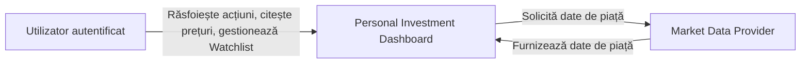
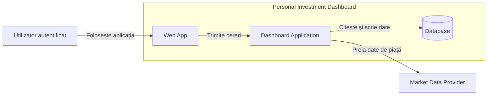
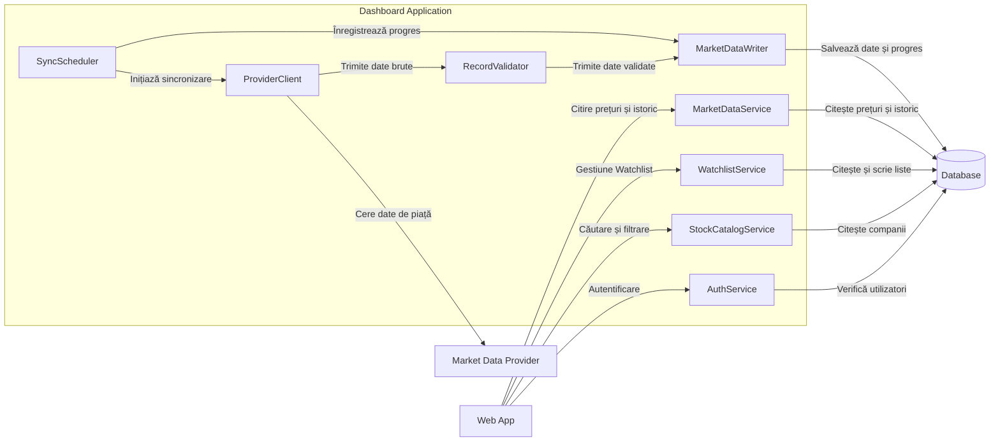
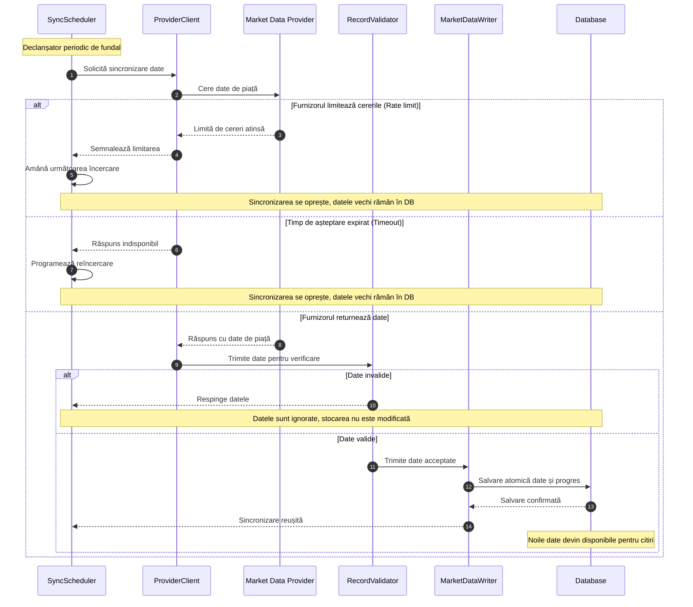
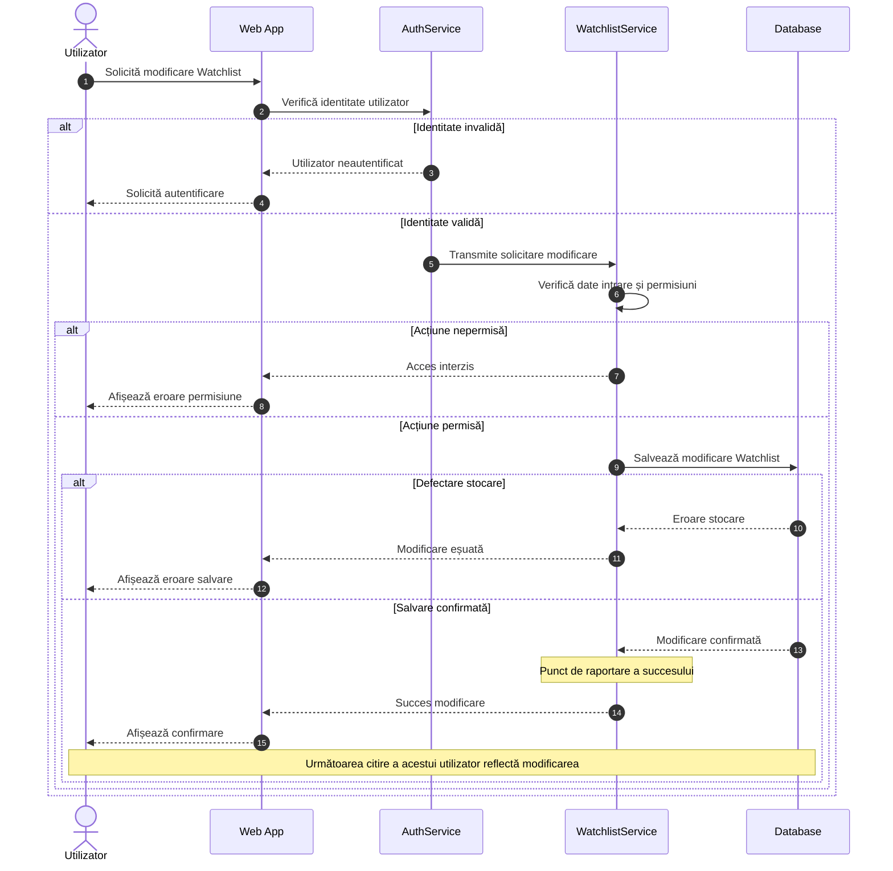

# Laboratorul 3: Desenează limita Dashboard-ului (Baseline Architecture)

## 1. Diagrama System Context (Nivelul 1 C4)

### Diagrama Mermaid System Context

### Semnificația elementelor și a relațiilor

* **Utilizator autentificat:** Actorul uman (investitor sau trader) care interacționează direct cu aplicația pentru a consulta cotațiile, graficele de istoric, a căuta instrumente financiare și a administra propria listă de urmărire (*Watchlist*).
* **Personal Investment Dashboard:** Sistemul proiectat, privit ca o cutie neagră (*black box*). Toate detaliile interne de execuție, procesele și bazele de date sunt ascunse la acest nivel.
* **Market Data Provider:** Sistem extern independent care furnizează cotații de piață și date istorice. Are propriile politici de disponibilitate, latență și limitare a numărului de cereri.
* **Relația PID $\rightarrow$ Furnizor:** Sistemul preia periodic datele necesare pentru catalogul de 5.629 de acțiuni definit în Laboratorul 2.
* **Relația Furnizor $\rightarrow$ PID:** Răspunsurile furnizorului conțin cotații însoțite de momentul de observare al pieței (*provider timestamp*).

---

## 2. Diagrama Container (Nivelul 2 C4)

### Diagrama Mermaid Container

### Responsabilitățile containerelor

Am ales cel mai mic set viabil de containere, conform principiului *Monolith First* (recomandat de Martin Fowler și Lecția 4), pentru a evita complexitatea și latența rețelei introduse de microservicii premature:

| Container | Rol și responsabilitate |
| :--- | :--- |
| **Web App** | Aplicație client (Single-Page Application) care rulează în browserul utilizatorului. Randează interfața grafică, preia acțiunile utilizatorului și afișează stările datelor (`normal`, `întârziat`, `indisponibil`). |
| **Dashboard Application** | Aplicația principală de server (monolit modular). Primește solicitările de la Web App, verifică identitatea și permisiunile, procesează logica de business, citește datele din baza de date și rulează în fundal sincronizarea cu furnizorul extern. |
| **Database** | Stocarea de date persistentă a sistemului. Păstrează conturile de utilizatori, listele private Watchlist, datele de referință ale acțiunilor, cotațiile curente și istoricul pe 5 ani. Asigură tranzacții sigure pentru scrieri. |

### Decizii cheie de arhitectură:
1. **Decuplarea citirilor de furnizor:** Nicio acțiune a utilizatorului din `Web App` nu apelează direct `Market Data Provider`. Toate cererile trec prin `Dashboard Application`, care servește datele din stocarea locală.
2. **Păstrarea secretelor pe server:** Cheile de acces către API-ul furnizorului extern sunt stocate exclusiv pe server în `Dashboard Application`, nefiind expuse niciodată în codul sau browserul clientului.

---

## 3. Diagrama Component (Nivelul 3 C4)

Deschidem exclusiv containerul **Dashboard Application** pentru a evidenția componentele sale interne și responsabilitățile acestora. Containerele adiacente (`Web App`, `Database`) și sistemul extern (`Market Data Provider`) rămân în afara limitei containerului.

### Diagrama Mermaid Component

### Responsabilitățile componentelor interne

| Componentă | Responsabilitate |
| :--- | :--- |
| **AuthService** | Verifică identitatea utilizatorului la fiecare solicitare protejată. |
| **StockCatalogService** | Asigură căutarea și filtrarea companiilor din catalog (cele 5.629 de acțiuni). |
| **WatchlistService** | Gestionează listele private de urmărire; verifică permisiunea de acces (proprietatea listei) și asigură consistența datelor private. |
| **MarketDataService** | Răspunde la cererile de preț și istoric ale clienților; evaluează prospețimea cotațiilor (stare normală, întârziată sau indisponibilă). |
| **SyncScheduler** | Coordonează sincronizarea periodică în fundal; deduplică operațiile și gestionează pauzele la erori. |
| **ProviderClient** | Gestionează comunicarea externă securizată cu furnizorul; deține credențialele de acces pe server și tratează pauzele de rețea sau limitările de cereri. |
| **RecordValidator** | Verifică integritatea datelor primite de la furnizor (câmpuri obligatorii, valori pozitive, timestamp-uri valide) și respinge înregistrările corupte. |
| **MarketDataWriter** | Salvează atomic în baza de date loturile de date validate împreună cu marcajul de progres al sincronizării. |

---

## 4. Diagrame de secvență

### A. Sincronizează datele de piață

#### Ipoteze inițiale:
1. Sincronizarea este pornită periodic de un timer intern în `SyncScheduler` (în fundal).
2. Credențialele de acces către furnizor sunt păstrate strict pe server în `ProviderClient`.
3. Dacă sincronizarea eșuează (limitare de cereri, timeout sau date invalide), **datele anterior salvate în baza de date rămân neschimbate** și continuă să fie servite.
4. Datele noi devin disponibile pentru citirile ulterioare numai după confirmarea salvării în baza de date.

---

### B. Citește prețul unui Stock

#### Ipoteze inițiale:
1. Utilizatorul cere prețul unei acțiuni din interfață.
2. **Citirea utilizatorului NU declanșează o cerere nouă către furnizor.** Datele se citesc strict din stocarea locală.
3. Reguli de afișare bazate pe vechimea datelor (din Lab 2):
   * $\le$ 16 minute: preț afișat normal.
   * Între 16 și 30 minute: preț afișat cu eticheta `întârziat`.
   * Peste 30 minute: prețul este considerat expirat și se afișează `indisponibil` (niciodată `0`).
4. În caz de defectare a stocării sau simbol inexistent, utilizatorul vede explicit starea `indisponibil`.

---

### C. Modifică un Watchlist privat

#### Ipoteze inițiale:
1. Utilizatorul solicită adăugarea sau ștergerea unei acțiuni din Watchlist.
2. Se verifică obligatoriu identitatea, datele de intrare și permisiunea (utilizatorul poate modifica doar propria listă).
3. **Punctul de raportare a succesului:** Succesul este confirmat utilizatorului **doar după ce salvarea a reușit în baza de date**.
4. **Garanția Read-Your-Own-Writes:** Odată confirmată salvarea, următoarea citire a Watchlist-ului de către același utilizator reflectă garantat modificarea efectuată.

---

## 5. Surse și cercetare

1. **Simon Brown: The C4 Model for Visualising Software Architecture**  
   *URL:* https://c4model.com/  
   Fundamentează descompunerea ierarhică a sistemului pe niveluri clare de abstractizare (System Context, Container, Component).
2. **Martin Fowler: MonolithFirst**  
   *URL:* https://martinfowler.com/bliki/MonolithFirst.html  
   Argumentează începerea proiectării cu un monolit modular bine delimitat înainte de a împărți sistemul în servicii distribuite.
3. **Martin Kleppmann: Designing Data-Intensive Applications (DDIA)**  
   *URL:* [Cartea în format PDF](https://0-lucas.github.io/digital-garden/99.-Books/Martin-Kleppmann---Designing-Data-Intensive-Applications_-O%E2%80%99Reilly-Media-(2017).pdf)  
   Fundamentează decuplarea citirilor utilizatorilor de dependențele externe lente și modelele de consistență (*Bounded Staleness* și *Read-Your-Own-Writes*).
4. **Google SRE Book: Addressing Cascading Failures**  
   *URL:* https://sre.google/sre-book/addressing-cascading-failures/  
   Explică mecanismele de protecție împotriva defectării furnizorilor externi prin timeout-uri și politici de reîncercare cu pauză.
5. **OWASP Authorization Cheat Sheet**  
   *URL:* https://cheatsheetseries.owasp.org/cheatsheets/Authorization_Cheat_Sheet.html  
   Fundamentează verificarea explicită a identității și a permisiunilor înainte de procesarea oricărei modificări de date.

---

## 6. Listă de verificare (Checklist)

- [x] Am inclus o diagramă System Context, una Container și una Component.
- [x] Am inclus cele trei diagrame de secvență cerute (Sincronizare piață, Citire preț, Modificare Watchlist).
- [x] Toate blocurile Mermaid sunt simple, conțin doar denumirile, fără detalii de implementare premature.
- [x] Diagrama Component deschide numai Dashboard Application.
- [x] Fluxurile de secvență arată rezultate normale, acțiuni respinse și defectări.
- [x] Proiectarea acoperă citirile, datele private, sincronizarea cu furnizorul și defectările.
- [x] Am precizat ipotezele inițiale sub fiecare diagramă de secvență.
- [x] Am specificat clar că o citire a utilizatorului nu apelează furnizorul extern.
- [x] Am marcat punctul de raportare a succesului și comportamentul următoarei citiri la Watchlist (Read-Your-Own-Writes).
