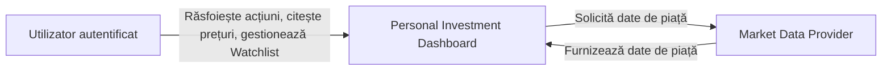
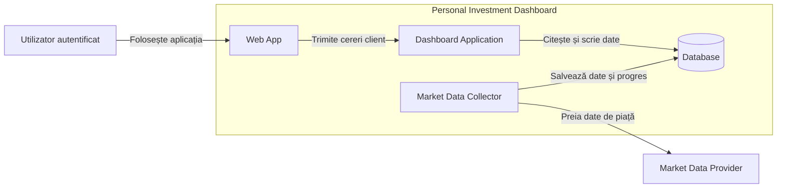
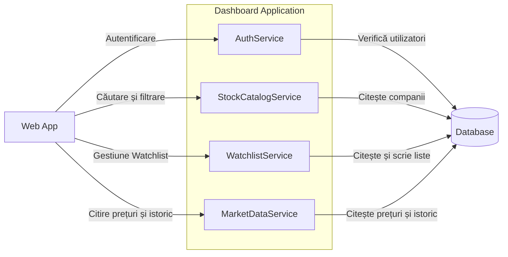
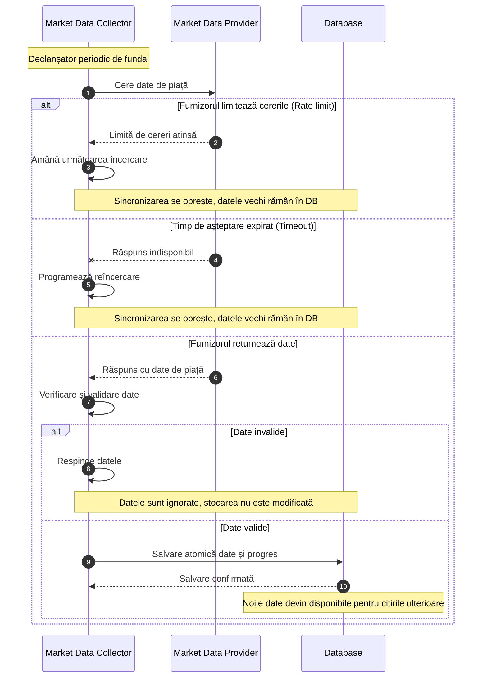
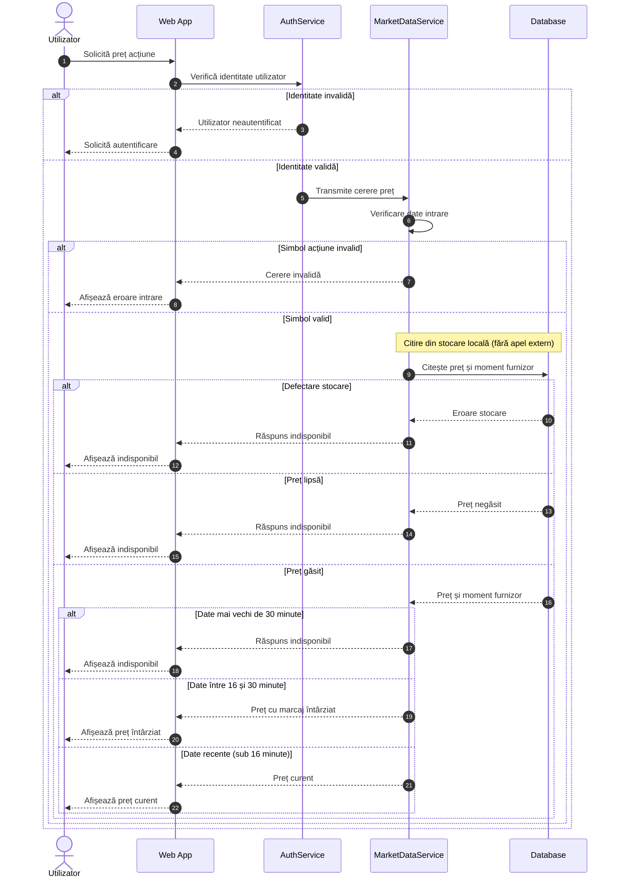
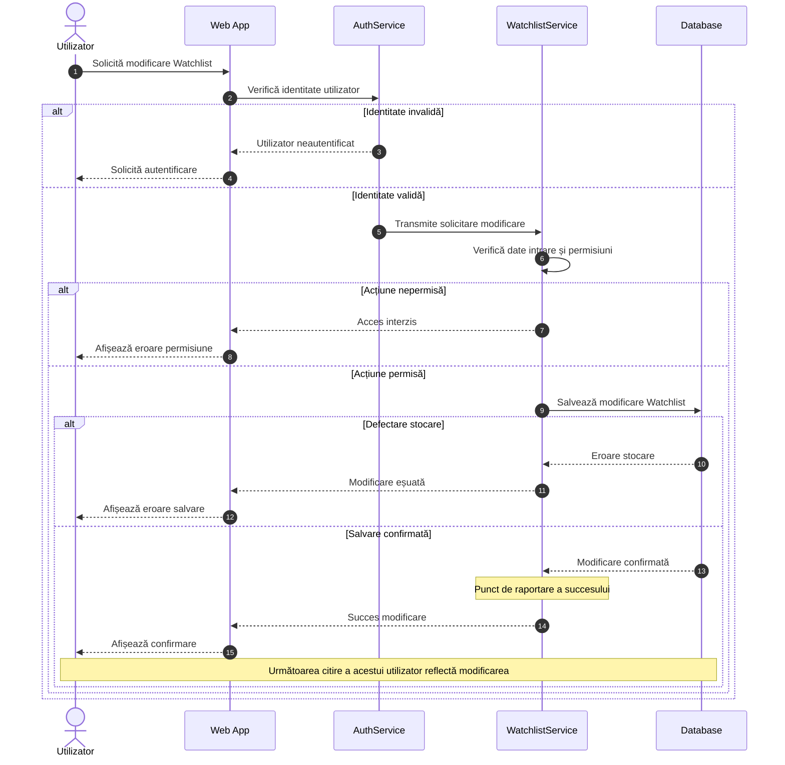

# Laboratorul 3: Desenează limita Dashboard-ului (Baseline Architecture)

## 1. Diagrama System Context (Nivelul 1 C4)

### Diagrama Mermaid System Context

### Semnificația elementelor și a relațiilor

* **Utilizator autentificat:** Actorul uman (investitor sau trader) care interacționează direct cu aplicația pentru a consulta cotațiile, graficele de istoric, a căuta instrumente financiare și a administra propria listă de urmărire (*Watchlist*).
* **Personal Investment Dashboard:** Sistemul proiectat, privit ca o cutie neagră (*black box*). Toate detaliile interne de execuție, procesele și bazele de date sunt ascunse la acest nivel.
* **Market Data Provider:** Sistem extern independent care furnizează cotații de piață și date istorice. Are propriile politici de disponibilitate, latență și limitare a numărului de cereri.
* **Relația PID $\rightarrow$ Furnizor:** Sistemul preia periodic datele necesare pentru catalogul de 5.629 de acțiuni definit în Laboratorul 2.
* **Relația Furnizor $\rightarrow$ PID:** Răspunsurile furnizorului conțin cotații însoțite de momentul de observare al pieței (*provider timestamp*).

---

## 2. Diagrama Container (Nivelul 2 C4)

Pe nivelul de containere deschidem limita sistemului și separăm clar două fluxuri fundamentale:
1. **Fluxul de servire a utilizatorilor:** gestionat de `Web App` și `Dashboard Application`.
2. **Fluxul de preluare și sincronizare a pieței:** izolat complet într-un container separat, **`Market Data Collector`**.

### Diagrama Mermaid Container

### Responsabilitățile containerelor

| Container | Rol și responsabilitate |
| :--- | :--- |
| **Web App** | Aplicație client (Single-Page Application) care rulează în browserul utilizatorului. Randează interfața grafică, preia acțiunile utilizatorului și afișează stările datelor (`normal`, `întârziat`, `indisponibil`). |
| **Dashboard Application** | Aplicație server dedicată clienților. Expune API-ul, verifică identitatea și permisiunile, gestionează logica de afișare și Watchlist-ul privat și citește datele de piață din baza de date. |
| **Market Data Collector** | Serviciu de fundal independent (worker). Se ocupă exclusiv de sincronizarea periodică cu `Market Data Provider`: deține credențialele API pe server, gestionează limitările de rată/timeout-urile, validează datele primite și le scrie atomic în baza de date. |
| **Database** | Stocarea de date persistentă a sistemului. Păstrează conturile de utilizatori, listele private Watchlist, datele de referință ale acțiunilor, cotațiile curente, istoricul pe 5 ani și progresul sincronizării. |

### Decizii cheie de arhitectură:
1. **Decuplarea totală a citirilor de furnizorul extern:** `Dashboard Application` citește exclusiv din `Database` și nu comunică niciodată direct cu `Market Data Provider`. Acest lucru garantează că citirile utilizatorilor nu depind de latența sau căderile furnizorului extern.
2. **Izolarea responsabilității de sincronizare:** `Market Data Collector` este singurul container care contactează furnizorul extern și deține cheile de securitate API. Dacă sincronizarea eșuează sau furnizorul este blocat, `Dashboard Application` continuă să servească utilizatorilor datele existente în baza de date.

---

## 3. Diagrama Component (Nivelul 3 C4)

În conformitate cu cerința C4, deschidem **exclusiv containerul `Dashboard Application`**. `Web App` și `Database` sunt containere adiacente care comunică direct cu el. `Market Data Collector` și `Market Data Provider` nu apar în această diagramă, deoarece comunicarea cu datele de piață se face asincron prin `Database`.

### Diagrama Mermaid Component

### Responsabilitățile componentelor din Dashboard Application

| Componentă | Responsabilitate |
| :--- | :--- |
| **AuthService** | Verifică identitatea utilizatorului (token / sesiune) la fiecare solicitare protejată. |
| **StockCatalogService** | Asigură căutarea și filtrarea companiilor din catalog (cele 5.629 de acțiuni SUA active). |
| **WatchlistService** | Gestionează listele private de urmărire; verifică permisiunea de acces (dreptul de proprietate asupra listei) și impune garanția *Read-Your-Own-Writes*. |
| **MarketDataService** | Răspunde la cererile de preț curent și istoric prin interogarea bazei de date locale; evaluează prospețimea conform regulilor *Bounded Staleness* (normal sub 16 min, întârziat între 16-30 min, indisponibil peste 30 min). |

*(Notă: Componentele de sincronizare precum planificatorul, clientul HTTP cu credențiale și validatorul de date aparțin containerului separat `Market Data Collector` și nu încarcă `Dashboard Application`).*

---

## 4. Diagrame de secvență

### A. Sincronizează datele de piață

#### Ipoteze inițiale:
1. Sincronizarea este declanșată periodic în fundal de către `Market Data Collector`.
2. Credențialele de acces către furnizor sunt păstrate strict pe server în `Market Data Collector`.
3. Dacă sincronizarea eșuează (limitare de cereri, timeout sau date invalide), **datele anterior salvate în baza de date rămân neschimbate** și continuă să fie servite.
4. Datele noi devin disponibile pentru citiri doar după confirmarea salvării durabile în baza de date.

---

### B. Citește prețul unui Stock

#### Ipoteze inițiale:
1. Utilizatorul cere prețul unei acțiuni din interfață.
2. **Citirea utilizatorului NU apelează furnizorul extern și nici colectorul.** Datele se citesc strict din baza de date locală de către `MarketDataService`.
3. Reguli de afișare bazate pe vechimea datelor (din Lab 2):
   * $\le$ 16 minute: preț afișat normal.
   * Între 16 și 30 minute: preț afișat cu eticheta `întârziat`.
   * Peste 30 minute: prețul este considerat expirat și se afișează `indisponibil` (niciodată `0`).
4. În caz de defectare a stocării sau simbol inexistent, utilizatorul vede explicit starea `indisponibil`.

---

### C. Modifică un Watchlist privat

#### Ipoteze inițiale:
1. Utilizatorul solicită adăugarea sau ștergerea unei acțiuni din Watchlist.
2. Se verifică obligatoriu identitatea, datele de intrare și permisiunea (utilizatorul poate modifica doar propria listă).
3. **Punctul de raportare a succesului:** Succesul este confirmat utilizatorului **doar după ce salvarea a reușit în baza de date**.
4. **Garanția Read-Your-Own-Writes:** Odată confirmată salvarea, următoarea citire a Watchlist-ului de către același utilizator reflectă garantat modificarea efectuată.

---

## 5. Surse și cercetare

1. **Simon Brown: The C4 Model for Visualising Software Architecture**  
   *URL:* https://c4model.com/  
   Fundamentează descompunerea ierarhică și separarea responsabilităților de execuție în containere distincte: aplicația client, serverul de API și colectorul de fundal.
2. **Martin Fowler: MonolithFirst**  
   *URL:* https://martinfowler.com/bliki/MonolithFirst.html  
   Explică delimitarea clară a responsabilităților și izolarea proceselor de fundal de cele orientate spre clienți.
3. **Martin Kleppmann: Designing Data-Intensive Applications (DDIA)**  
   *URL:* [Cartea în format PDF](https://0-lucas.github.io/digital-garden/99.-Books/Martin-Kleppmann---Designing-Data-Intensive-Applications_-O%E2%80%99Reilly-Media-(2017).pdf)  
   Fundamentează decuplarea citirilor utilizatorilor de dependențele externe lente prin stocare intermediară și aplicarea modelelor de consistență (*Bounded Staleness* și *Read-Your-Own-Writes*).
4. **Google SRE Book: Addressing Cascading Failures**  
   *URL:* https://sre.google/sre-book/addressing-cascading-failures/  
   Explică mecanismele de protecție împotriva defectării furnizorilor externi prin timeout-uri și politici de reîncercare cu pauză în procesele colectoare.
5. **OWASP Authorization Cheat Sheet**  
   *URL:* https://cheatsheetseries.owasp.org/cheatsheets/Authorization_Cheat_Sheet.html  
   Fundamentează verificarea explicită a identității și a permisiunilor înainte de procesarea oricărei modificări de date private.

---

## 6. Listă de verificare (Checklist)

- [x] Am inclus o diagramă System Context, una Container și una Component.
- [x] Diagrama Container include containerul separat `Market Data Collector`.
- [x] Diagrama Component deschide numai `Dashboard Application` (fără colector sau servicii externe).
- [x] Am inclus cele trei diagrame de secvență cerute (Sincronizare piață, Citire preț, Modificare Watchlist).
- [x] Toate blocurile Mermaid sunt simple, conțin doar denumirile, fără detalii de implementare premature.
- [x] Fluxurile de secvență arată rezultate normale, acțiuni respinse și defectări.
- [x] Proiectarea acoperă citirile, datele private, sincronizarea cu furnizorul și defectările.
- [x] Am precizat ipotezele inițiale sub fiecare diagramă de secvență.
- [x] Am specificat clar că o citire a utilizatorului nu apelează furnizorul extern și nici colectorul.
- [x] Am marcat punctul de raportare a succesului și comportamentul următoarei citiri la Watchlist (Read-Your-Own-Writes).
