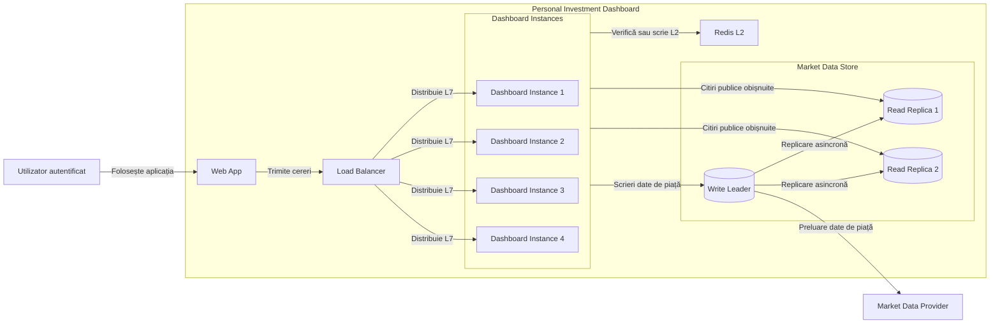
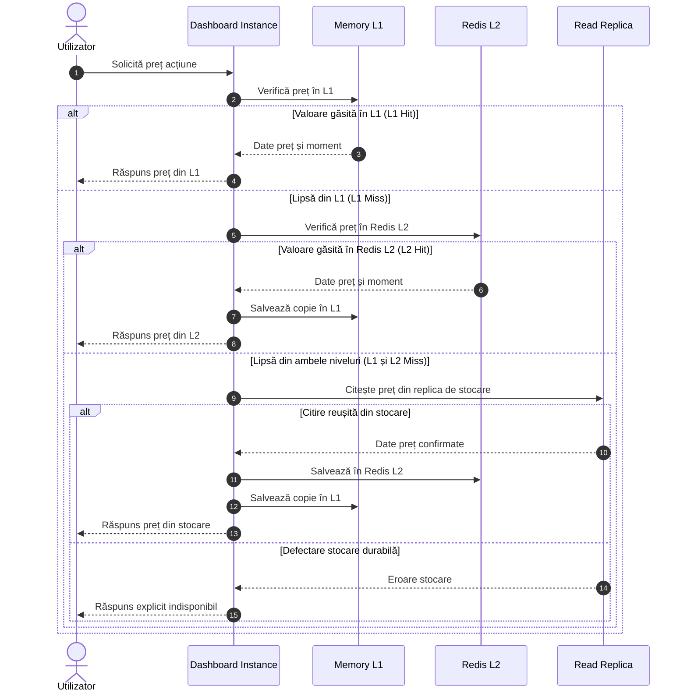
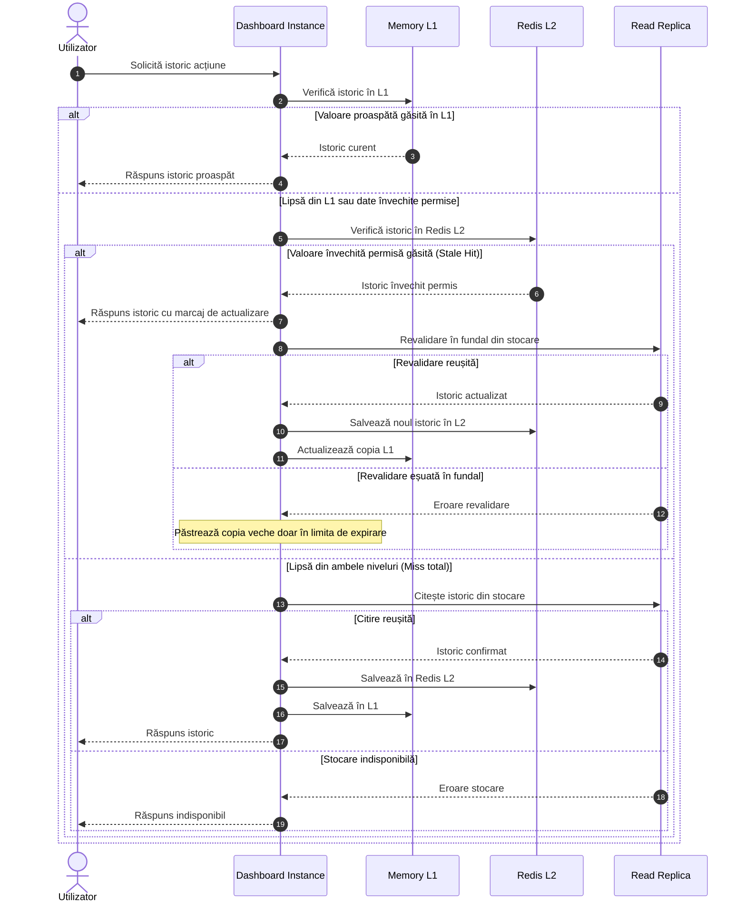

# Laboratorul 4: Scalează traseul de citire al Dashboard-ului

## 1. Scalează serviciul și rutează cererile

### Calculul țintei de trafic și al numărului de instanțe Dashboard

Datele de pornire din cerință:
* Volumul de bază la 3.000 de utilizatori: **600 RPS** (citiri ale prețurilor acțiunilor).
* Marjă de capacitate impusă: **20%**.
* Capacitate sigură per instanță Dashboard: **250 RPS** (cu respectarea țintei de latență $p50 \le 150\text{ ms}$ și $p95 \le 500\text{ ms}$).

1. **Ținta de capacitate cu marjă inclusă:**
   $$\text{Țintă} = 600\text{ RPS} \times 1.20 = 720\text{ RPS}$$

2. **Numărul minim de instanțe în regim normal:**
   $$N_{\text{normal}} = \left\lceil \frac{720\text{ RPS}}{250\text{ RPS}} \right\rceil = \lceil 2.88 \rceil = 3\text{ instanțe}$$

3. **Garantarea disponibilității la oprirea unei instanțe ($N - 1$):**
   * Dacă pornim cu 3 instanțe și una se oprește:
     $$(3 - 1) \times 250\text{ RPS} = 2 \times 250\text{ RPS} = 500\text{ RPS} < 720\text{ RPS} \quad (\text{insuficient})$$
   * Dacă pornim cu 4 instanțe și una se oprește:
     $$(4 - 1) \times 250\text{ RPS} = 3 \times 250\text{ RPS} = 750\text{ RPS} \ge 720\text{ RPS} \quad (\text{suficient})$$

**Concluzie:** Sistemul are nevoie de cel puțin **4 instanțe Dashboard active și pregătite** (*ready*) pentru a susține vârful de trafic chiar și în cazul defectării neașteptate a unei instanțe.

---

### Distribuitorul de trafic: Nivel și metodă de selecție

* **Nivelul ales: Nivelul 7 (L7 - HTTP/HTTPS)**
  * *Motiv:* Permite terminarea conexiunilor securizate TLS, inspecția căilor HTTP (separarea citirilor de cotații de operațiile private pe Watchlist) și verificări de sănătate la nivel de aplicație (`/ready`).
* **Metoda de selecție: Cele mai puține conexiuni (*Least Connections*)**
  * *Motiv:* Deși cererile de preț au costuri teoretice similare de procesare, în practică pot apărea variații de latență cauzate de evacuări din memoria cache sau pauze de garbage collection. Metoda direcționează cererile noi către instanța cu cele mai puține conexiuni active, asigurând o echilibrare uniformă a timpilor de răspuns.
  * *Limita principală:* Numărul de conexiuni active este doar un indicator indirect al încărcării reale. O conexiune lentă a unui client pe o rețea mobilă poate ține un socket deschis fără a consuma timp CPU, ceea ce poate induce în eroare algoritmul de distribuție.

---

### Gestionarea stării (Stateless vs. Durabil)

* **Date durabile (se păstrează obligatoriu la oprirea oricărei instanțe):**
  * Conturile utilizatorilor, listele private Watchlist, datele de referință ale acțiunilor, cotațiile de piață și istoricul EOD pe 5 ani sunt stocate durabil în baza de date și în cache-ul partajat Redis L2.
  * Autentificarea este decuplată (token-uri semnate / chei de sesiune distribuite), astfel încât orice instanță poate procesa cererile ulterioare fără întrerupere.
* **Date temporare (pot fi pierdute fără impact la oprirea unei instanțe):**
  * Copiile de memorie din cache-ul local L1 al procesului respectiv.
  * Conexiunile TCP în curs și bufferele de parsare ale cererilor curente (clientul reîncearcă automat pe o altă instanță).

---

## 2. Scalează Market Data Store

### Calculul capacității de stocare

* Capacitatea unui nod de stocare: **400 RPS** de citire publică.
* Regula impusă: Liderul de scriere (*Write Leader*) este rezervat pentru salvarea datelor acceptate de la furnizor și citirile sensibile la prospețime maximă; **nu este inclus în capacitatea de citire publică obișnuită**.
* Cererea de citire publică: **720 RPS**.
* Număr de replici de citire necesare:
  $$\left\lceil \frac{720\text{ RPS}}{400\text{ RPS}} \right\rceil = 2\text{ replici de citire}$$
  Capacitate totală oferită de replici: $2 \times 400\text{ RPS} = 800\text{ RPS} \ge 720\text{ RPS}$.

Arhitectura stocării folosește **1 Lider de scriere** și **2 Replici de citire** (*Read Replicas*), actualizate asincron prin fluxul de replici al bazei de date (PostgreSQL WAL).

---

### Diagrama Mermaid Container actualizată



### Semnificația elementelor din Container View:
* **Load Balancer (L7):** Punctul unic de intrare; termină conexiunile HTTPS și trimite cererile către instanțele pregătite folosind *Least Connections*.
* **Dashboard Instances (1–4):** Instanțe echivalente, fără stare locală necesară între cereri (*stateless*), care procesează cererile și dețin propriul cache L1 în memorie.
* **Redis L2:** Serviciu partajat de cache în memorie, accesibil tuturor instanțelor Dashboard.
* **Market Data Store (Leader + 2 Replicas):** Clusterul de bază de date relațională. Liderul procesează scrierile datelor de piață și propagă modificările către cele două replici de citire.

---

## 3. Pune în cache două citiri publice

Am selectat două citiri publice (fără date private):
1. **Cazul 1: Prețul Acțiunii (`Stock price`)** – citire cu frecvență foarte mare (generează peste 75% din trafic), unde cache-ul elimină interogarea repetată a replicilor de date.
2. **Cazul 2: Istoricul Acțiunii (`History`)** – citire a barelor zilnice EOD pe 5 ani (1.260 înregistrări per acțiune), unde cache-ul elimină transferul și serializarea repetată a seturilor mari de date.

### Contractul pentru cache

| Criteriu de decizie | Cazul 1: Prețul Acțiunii (`Stock price`) | Cazul 2: Istoricul Acțiunii (`History`) |
| :--- | :--- | :--- |
| **Cheie** | `stock:price:{ticker}` | `stock:history:{ticker}:5y` |
| **Valoare stocată** | JSON cu cotația, momentul pieței (`provider_time`) și `cached_at` | JSON cu lista barelor OHLCV, data ultimei bare și `cached_at` |
| **Sursă durabilă** | Replicile de citire din Market Data Store | Replicile de citire din Market Data Store |
| **Durată de viață L1** | 5 secunde | 60 secunde |
| **Politica de actualitate** | **TTL simplu:** 60 secunde în Redis L2. Verificare regulă *Bounded Staleness* ($\le 16\text{ min}$ curent, $16-30\text{ min}$ întârziat, $> 30\text{ min}$ indisponibil). | **Stale-While-Revalidate:** Date actuale: $\le 1\text{ oră}$; Date învechite permise: până la 24 ore cu revalidare în fundal; TTL Redis: 24 ore. |
| **Rezultat la defectare** | Dacă L1 și L2 lipsesc, se interoghează replica de citire. Dacă stocarea eșuează, se returnează explicit `indisponibil` (fără valoarea `0`). | Se returnează copia învechită (dacă este sub limita de 24 ore); altfel, dacă stocarea eșuează, se afișează `indisponibil`. |

---

### Diagrama de secvență: Citirea din cache a prețului unei acțiuni (Cazul 1)

Diagrama arată traseul complet: găsire în L1, găsire în Redis L2 la lipsă din L1, citire din stocare durabilă la lipsă din ambele și rezultatul în caz de defectare a stocării.



---

### Diagrama de secvență: Citirea istoricului cu Stale-While-Revalidate (Cazul 2)



---

### Reguli de încărcare în avans (*Cache Warming*) și acces de rezervă

1. **Setul limitat de chei încărcat în avans:**
   * Înainte de deschiderea pieței sau după repornirea Redis, sistemul preîncarcă în cache doar cele mai tranzacționate **500 de acțiuni** (acțiunile din indicele S&P 500, care generează majoritatea traficului din cele 5.629 de companii).
   * Restul de 5.129 de acțiuni mai puțin active sunt încărcate la cerere (*cache-aside*).
2. **Comportament la încărcare incompletă sau capacitate de rezervă epuizată:**
   * Dacă Redis repornește gol și procesul de preîncărcare nu s-a finalizat, cererile concurente citesc replicile de stocare.
   * Dacă volumul de cereri depășește capacitatea sigură a celor două replici (800 RPS), sistemul aplică respingerea controlată a surplusului de cereri (*load shedding*), returnând imediat starea `indisponibil` pentru a proteja baza de date împotriva căderii în cascadă.

---

## 4. Implementează traseul cache-ului Redis prin comenzi

### Cazul 1: Prețul Acțiunii (`stock:price:AAPL`)

Transcriere comenzi `redis-cli`:

```text
# 1. Verificare inițială (cheia lipsește din cache)
127.0.0.1:6379> GET stock:price:AAPL
(nil)

# 2. Salvare în Redis cu expirare EX de 60 de secunde (după citirea din stocare)
127.0.0.1:6379> SET stock:price:AAPL '{"ticker":"AAPL","price":182.50,"provider_time":"2026-10-28T09:00:00Z","cached_at":"2026-10-28T09:01:00Z"}' EX 60
OK

# 3. Recitire și verificare durată de viață rămasă
127.0.0.1:6379> GET stock:price:AAPL
"{\"ticker\":\"AAPL\",\"price\":182.50,\"provider_time\":\"2026-10-28T09:00:00Z\",\"cached_at\":\"2026-10-28T09:01:00Z\"}"

127.0.0.1:6379> TTL stock:price:AAPL
(integer) 58
```

---

### Cazul 2: Istoricul Acțiunii (`stock:history:AAPL:5y`)

Transcriere comenzi `redis-cli`:

```text
# 1. Verificare inițială (cheia lipsește din cache)
127.0.0.1:6379> GET stock:history:AAPL:5y
(nil)

# 2. Salvare în Redis cu expirare EX de 86400 secunde (24 ore)
127.0.0.1:6379> SET stock:history:AAPL:5y '{"ticker":"AAPL","bars_count":1260,"eod_date":"2026-10-27","cached_at":"2026-10-28T09:01:00Z"}' EX 86400
OK

# 3. Recitire și verificare durată de viață rămasă
127.0.0.1:6379> GET stock:history:AAPL:5y
"{\"ticker\":\"AAPL\",\"bars_count\":1260,\"eod_date\":\"2026-10-27\",\"cached_at\":\"2026-10-28T09:01:00Z\"}"

127.0.0.1:6379> TTL stock:history:AAPL:5y
(integer) 86395
```

---

### De ce un TTL Redis nu dovedește actualitatea datelor sursă

* Valoarea `TTL` din Redis măsoară exclusiv timpul scurs de la momentul în care intrarea a fost scrisă în memoria Redis (`cached_at`).
* Momentul pieței (`provider_time`) reprezintă momentul real la care bursa a observat acel preț.
* **Exemplu critic:** Dacă furnizorul livrează o cotație cu o întârziere de 20 de minute de la piață, iar noi o salvăm în Redis cu `EX 60`, după 10 secunde comanda `TTL` returnează `50` (cheia este validă în Redis), dar datele din lumea reală au o vechime de $20\text{ min} + 10\text{ s} > 16\text{ min}$. Conform regulilor din Laboratorul 2, Dashboard-ul trebuie să afișeze cotația etichetată obligatoriu ca `întârziat`, ghidându-se după `provider_time`, nu după `TTL`-ul din Redis.

---

### Alegerea persistenței Redis

* **Modul ales:** **Fără persistență pe disc** (*No persistence* / cache pur în memorie).
* **Justificare:**
  * Redis este folosit strict ca nivel temporar de accelerare a citirilor (L2).
  * Datele durabile se află în `Market Data Store` (PostgreSQL), care este sursa autoritară de adevăr.
  * Dezactivarea scrierilor pe disc (RDB/AOF) elimină operațiile I/O de pe nodul Redis, oferind latențe minime și predictibile.
* **Ce se întâmplă la repornirea Redis:**
  * Redis pornește instantaneu cu memoria liberă.
  * Nicio stare durabilă a utilizatorilor sau a tranzacțiilor nu este pierdută.
  * Baza de date reconstruiește automat intrările necesare pe măsură ce cererile sosesc (*cache-aside*), sprijinită de încărcarea în avans a celor 500 de acțiuni principale.

---

## 5. Surse și cercetare

1. **Martin Kleppmann: Designing Data-Intensive Applications (DDIA)**  
   *URL:* [Cartea în format PDF](https://0-lucas.github.io/digital-garden/99.-Books/Martin-Kleppmann---Designing-Data-Intensive-Applications_-O%E2%80%99Reilly-Media-(2017).pdf)  
   Capitolul 5 explică arhitectura de replicare cu un singur lider (*Single-Leader Replication*), propagarea asincronă a jurnalului și diferențierea dintre capacitatea de citire și cea de scriere.
2. **Martin Fowler: MonolithFirst și Caching Patterns**  
   *URL:* https://martinfowler.com/bliki/MonolithFirst.html  
   Fundamentează scalarea pe orizontală a instanțelor unui monolit modular prin adăugarea de replici fără stare (*stateless*), păstrând simplitatea arhitecturii.
3. **Google SRE Book: Addressing Cascading Failures**  
   *URL:* https://sre.google/sre-book/addressing-cascading-failures/  
   Explică riscurile suprasolicitării stocării durabile la căderea cache-ului și necesitatea respingerii controlate a traficului (*load shedding*).
4. **NGINX: HTTP Load Balancing**  
   *URL:* https://nginx.org/en/docs/http/load_balancing.html  
   Compară metodele de rutare L7 (*Round Robin* vs. *Least Connections*) și explică mecanismele de verificare a sănătății instanțelor.
5. **IETF RFC 5861: HTTP Cache-Control Extensions for Stale Content**  
   *URL:* https://www.rfc-editor.org/rfc/rfc5861.html  
   Definește modelul *Stale-While-Revalidate*, justificând servirea asincronă a datelor învechite permise în timp ce revalidarea are loc în fundal.
6. **Redis Documentation: Cache-Aside Pattern & Key Expiration**  
   *URL:* https://redis.io/docs/latest/develop/use-cases/cache-aside/  
   Documentează operarea corectă a comenzilor `SET ... EX`, `GET` și `TTL` pentru sisteme de înaltă performanță.

---

## 6. Listă de verificare (Checklist)

- [x] Calculul pentru instanțele Dashboard include marja de 20% și pierderea unei instanțe ($N-1$).
- [x] Am ales nivelul de distribuire (L7) și metoda de selecție (*Least Connections*) și am explicat motivul și o limită.
- [x] Container View actualizat arată distribuitorul de trafic, instanțele serviciului și instanțele bazei de date.
- [x] Starea necesară se păstrează durabil după pierderea oricărei instanțe a serviciului.
- [x] Am două cazuri de utilizare a cache-ului (preț și istoric), cu un contract și o diagramă de secvență pentru fiecare, acoperind L1, Redis L2 și stocarea durabilă.
- [x] Cheile și valorile din cache nu conțin date private ale utilizatorilor.
- [x] Secvențele arată valori găsite în cache, valori lipsă, defectarea sursei și comportamentul stale-while-revalidate.
- [x] Încărcarea în avans este limitată (top 500 acțiuni), iar capacitatea de rezervă epuizată are un rezultat explicit indisponibil pentru utilizator.
- [x] Fiecare transcriere Redis arată comenzi concrete (`GET`, `SET ... EX`, `GET`, `TTL`), cu JSON și justificarea persistenței.
- [x] Am explicat de ce TTL-ul Redis nu dovedește actualitatea datelor din lumea reală.
- [x] Diagramele Mermaid sunt simple, conțin doar denumirile în casete și se randează fără erori.
