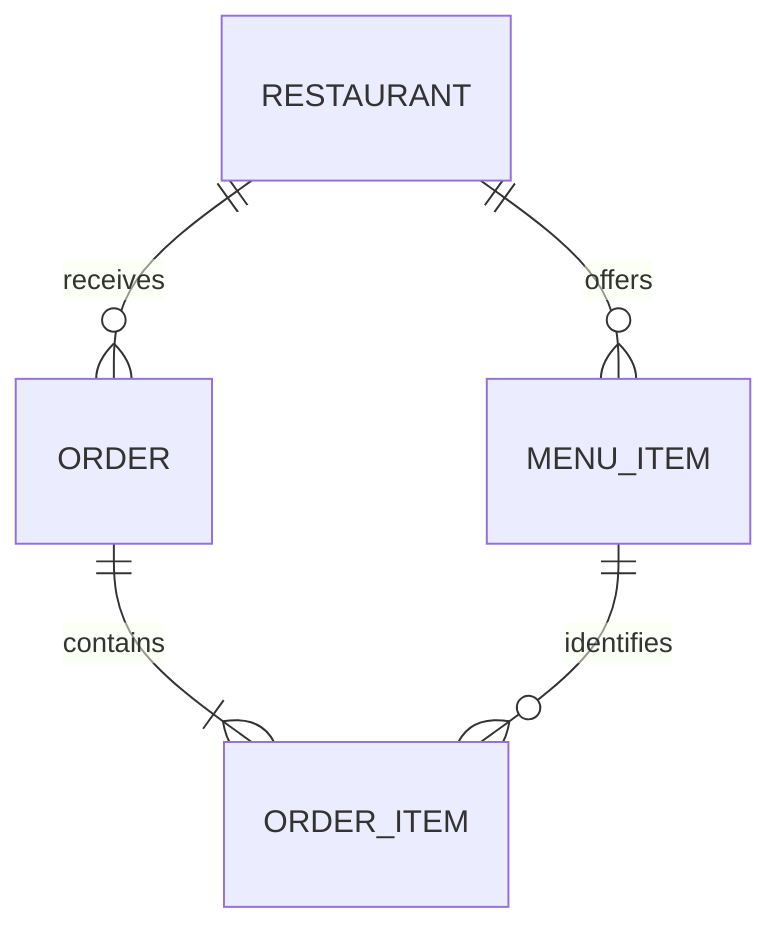
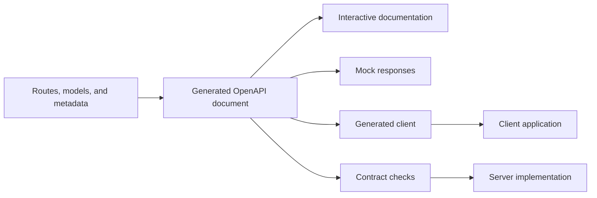
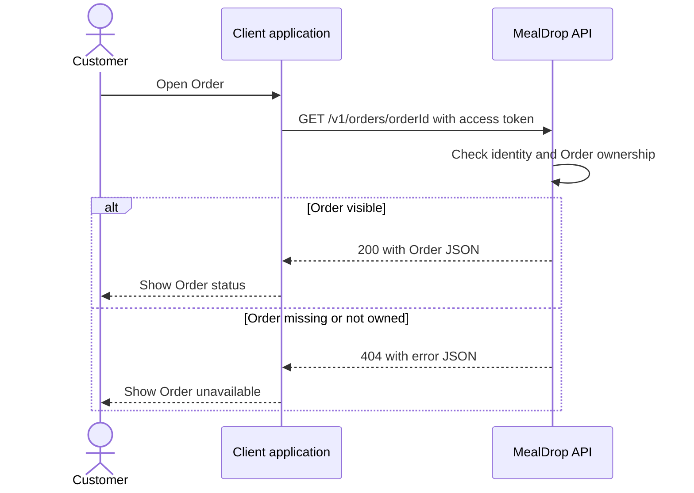

# Lecția 6: Modelarea datelor, proiectarea API-urilor și OpenAPI

Un client și un server trebuie să interpreteze o cerere în același mod. Un model
clar al datelor definește conceptele. Un API definește acțiunile. OpenAPI descrie
contractul, astfel încât oamenii și instrumentele să îl poată folosi.

```text
Product rules -> data model -> API contract -> OpenAPI -> client and server
```

Acest ghid folosește MealDrop. La final, ar trebui să poți modela entitățile sale
principale, să proiectezi un API mic, să descrii un endpoint în OpenAPI și să
apelezi acel endpoint dintr-un client.

## 1. Leagă conceptele din lecțiile anterioare

- [Lecția 2](lecture-02-product-scope-and-system-boundaries.md) a definit
  actorii, domeniul de aplicare și rezultatele observabile. Aceste rezultate
  ne arată de ce acțiuni are nevoie API-ul.
- [Lecția 3](lecture-03-quality-requirements-workload-and-capacity.md) a definit
  țintele de calitate. Un răspuns cu o listă trebuie să aibă o limită de dimensiune,
  pentru a limita volumul de muncă și timpul de răspuns.
- [Lecția 4](lecture-04-architecture-decomposition-and-data-flows.md) a stabilit
  unde se află clienții, serverele și verificările de acces. Acum definim mesajele dintre ele.
- [Lecția 5](lecture-05-horizontal-scaling-caching-and-availability.md) a adăugat
  instanțe ale serviciului. Fiecare instanță trebuie să expună același contract API.

Folosește o mică parte din MealDrop:

- Un Restaurant oferă produse în meniu.
- Un Client creează o Comandă cu produse de la un singur Restaurant.
- Clientul listează și citește propriile Comenzi.
- O Comandă păstrează produsele și prețurile convenite la trimitere.

## 2. Construiește un model clar al datelor

### Folosește o metodă de modelare și o notație comună

**Modelarea entitate-relație (ER)** descrie entitățile, atributele lor și relațiile
dintre ele. Peter Chen a introdus modelul în 1976. Acesta oferă o metodă de
organizare a informațiilor despre produs înainte de a alege o bază de date.

**UML** este un standard formal de modelare întreținut de Object Management
Group. O diagramă de clase UML poate descrie atribute, asocieri și multiplicități.
Modelarea ER este metoda folosită mai jos; diagrama noastră ER în Mermaid
folosește o notație uzuală pentru relații, nu notația diagramelor de clase UML.

Surse: [Chen: The Entity-Relationship Model](https://dl.acm.org/doi/10.1145/320434.320440)
și [OMG: UML 2.5.1](https://www.omg.org/spec/UML/2.5.1).

### Identifică entitățile, atributele și relațiile

O **entitate** își păstrează identitatea în timp. Un Restaurant își poate schimba
numele și rămâne același Restaurant. Un **atribut** descrie o entitate. O
**relație** leagă entități.

Folosește **snake_case pentru câmpurile stocate** și **camelCase pentru câmpurile API**.
Fă conversia între ele pe server. Modelul stocat păstrează informațiile necesare
pentru a construi un răspuns; nu trebuie să stocheze fiecare câmp din răspuns.

| Entitate   | Câmpuri stocate                                                                                | Relație                                             |
| ---------- | ---------------------------------------------------------------------------------------------- | --------------------------------------------------- |
| Restaurant | `restaurant_id`, `name`, `address`, `category`, `active`                                       | Oferă mai multe MenuItems                           |
| MenuItem   | `menu_item_id`, `restaurant_id`, `name`, `description`, `price`, `currency`, `available`       | Aparține unui singur Restaurant                     |
| Order      | `order_id`, `customer_id`, `restaurant_id`, `status`, `currency`, `delivery_fee`, `created_at` | Aparține unui singur Restaurant; conține OrderItems |
| OrderItem  | `order_id`, `line_number`, `menu_item_id`, `name_at_order`, `unit_price`, `quantity`           | Aparține unei singure Comenzi                       |

Începe cu regulile produsului, apoi desenează relațiile:



**Cardinalitate**: Fiecare MenuItem aparține exact unui Restaurant. Un Restaurant
poate să nu aibă încă produse în meniu. Fiecare Comandă conține cel puțin un OrderItem.

### Adaugă informații despre preț și disponibilitate

Aceste exemple de înregistrări stocate descriu starea curentă a unui Restaurant
și a unui MenuItem. JSON-ul de mai jos este un view lizibil al înregistrărilor,
cu numele câmpurilor stocate:

```json
{
  "restaurant": {
    "restaurant_id": "a1111111-1111-4111-8111-111111111111",
    "name": "Soup Kitchen",
    "address": "12 Market Street",
    "category": "Soups and salads",
    "active": true
  },
  "menu_item": {
    "menu_item_id": "b2222222-2222-4222-8222-222222222222",
    "restaurant_id": "a1111111-1111-4111-8111-111111111111",
    "name": "Tomato soup",
    "description": "Tomato soup with bread",
    "price": "4.50",
    "currency": "EUR",
    "available": true
  }
}
```

- Câmpul `active` al Restaurantului arată dacă acesta acceptă Comenzi noi în prezent.
- Câmpul `available` al MenuItem arată dacă acest produs poate fi comandat în prezent.
- Ambele trebuie să fie adevărate la trimitere. Verifică-le din nou pe server;
  meniul clientului poate fi vechi. Câmpul `status: "active"` al unei Comenzi are
  un sens propriu, definit în secțiunea despre API.
- Un preț are nevoie de o sumă și de o monedă. Fiecare produs și taxă din acest
  exemplu folosește EUR.
- OrderItem păstrează `name_at_order` și `unit_price` din achiziția convenită.
  O schimbare ulterioară a meniului nu rescrie o Comandă existentă.

### Calculează valorile derivate când este posibil

**Calculează valorile derivate când este posibil**, pentru a evita neconcordanțele
între valorile stocate. `subtotal` este suma prețurilor produselor înmulțite cu
cantitățile lor, înainte de taxa de livrare. `total` adaugă această taxă.

```text
subtotal = sum(quantity * agreed unit price)
total = subtotal + agreed delivery fee
```

Pentru două supe la `4.50`, subtotalul este `9.00`. Cu o taxă de livrare de `2.00`,
totalul este `11.00`. Acest exemplu folosește prețuri cu taxele incluse și nu
include alte costuri sau reduceri.

Stochează prețurile unitare convenite, cantitățile, moneda și taxa de livrare.
Calculează întotdeauna `subtotal` și `total` când construiești răspunsul API.
Nu stoca aceste câmpuri calculate în acest model și nu accepta valorile trimise
de client ca fiind de încredere. Astfel, o schimbare de cantitate sau de preț
nu lasă incorectă o a doua valoare stocată pentru total. Folosește aritmetică zecimală.

**Încearcă:** Un Client comandă două supe. Mâine, Restaurantul schimbă numele
supei și prețul ei. Ce câmpuri ar trebui să afișeze Comanda veche și de unde
ar trebui să provină acele informații?

Lectură: DDIA, prima ediție, capitolul 2, "Data Models and Query Languages."
[Site-ul cărții](https://dataintensive.net/) prezintă cartea. Concentrează-te pe
relații și pe costul informațiilor duplicate.

## 3. Transformă acțiunile Utilizatorului într-un API

### Începe cu REST și resursele

**REST** înseamnă Representational State Transfer. Este un stil arhitectural
pentru interacțiunea client-server. Clienții lucrează cu resurse denumite printr-o
interfață uniformă și schimbă reprezentări ale acelor resurse.

O **resursă** este un concept denumit de API, precum o Comandă. Răspunsul său JSON
este o **reprezentare**, nu resursa în sine. O **colecție** conține resurse de
același tip, precum Comenzile Clientului.

Pentru un API HTTP în stil REST:

- Folosește URL-uri pentru a identifica resursele și colecțiile.
- Folosește metode HTTP și coduri de stare standard, cu sensuri consecvente.
- Fă fiecare cerere completă în sine: trimite identitatea și datele de intrare
  necesare acelei cereri. Serverul păstrează în continuare datele persistente ale produsului.
- Precizează când răspunsurile pot fi păstrate în cache și protejează datele private.

REST complet folosește și linkuri în reprezentări pentru a indica acțiunile
disponibile. Această lecție se concentrează pe numele resurselor, reprezentări
și semantica HTTP. Aceeași resursă Comandă poate avea o reprezentare JSON sau XML.

Un **contract API** definește cererea acceptată și răspunsul promis.
O resursă poate combina mai multe entități. Răspunsul unei Comenzi poate conține
elementele sale OrderItems și un total calculat. Serverul transformă câmpul stocat
`order_id` în câmpul public `orderId` și calculează câmpurile derivate.

Sursă: [Fielding: REST, capitolul 5](https://ics.uci.edu/~fielding/pubs/dissertation/rest_arch_style.htm).

### Alege acțiunile pentru resurse

| Acțiunea Utilizatorului | Metodă și cale                          | Succes                                               |
| ----------------------- | --------------------------------------- | ---------------------------------------------------- |
| Creează o Comandă       | `POST /v1/orders`                       | `201 Created`, corpul Comenzii și antetul `Location` |
| Listează Comenzile mele | `GET /v1/orders?status=active&limit=20` | `200 OK` cu o listă filtrată și limitată             |
| Citește Comanda mea     | `GET /v1/orders/{orderId}`              | `200 OK` cu Comanda                                  |

Folosește metodele în mod consecvent:

- `GET`: citește o resursă sau o colecție.
- `POST`: trimite date pentru procesare, adesea pentru a crea o resursă.
- `PUT`: înlocuiește starea de la un URL cunoscut al unei resurse.
- `PATCH`: aplică o schimbare parțială.
- `DELETE`: șterge o resursă atunci când produsul permite ștergerea.

Alege acțiunile de care are nevoie produsul. O Comandă de mâncare acceptată
nu poate fi anulată prin ștergerea înregistrării sale. Anularea are nevoie de
reguli de afaceri proprii. Un `GET` nu trebuie să solicite o schimbare de afaceri,
precum crearea unei Comenzi.

Sursă: [Google AIP-121: Proiectare orientată pe resurse](https://google.aip.dev/121)
și [RFC 9110, secțiunea 9: Metode](https://www.rfc-editor.org/rfc/rfc9110.html#section-9).

### Separă datele de intrare de datele de ieșire

```http
POST /v1/orders
Content-Type: application/json
Authorization: Bearer <access-token>

{
  "restaurantId": "a1111111-1111-4111-8111-111111111111",
  "items": [
    {
      "menuItemId": "b2222222-2222-4222-8222-222222222222",
      "quantity": 2
    }
  ]
}
```

- Clientul trimite Restaurantul ales, produsele și cantitățile.
- Serverul obține ID-ul Clientului din autentificare.
- Serverul validează cererea și stabilește ID-ul și starea Comenzii.
- Serverul folosește prețurile convenite ale produselor. Un proces complet de
  finalizare a achiziției are nevoie și de o regulă pentru confirmarea acestor prețuri cu Clientul.

După crearea Comenzii, serverul returnează `201 Created`, un antet `Location`
cu URL-ul pentru citirea ei, produsele și prețurile convenite și sumele calculate:
`subtotal` și `total` sunt câmpuri de răspuns, nu câmpuri stocate ale Comenzii.

```json
{
  "orderId": "c3333333-3333-4333-8333-333333333333",
  "restaurantId": "a1111111-1111-4111-8111-111111111111",
  "status": "pending",
  "currency": "EUR",
  "items": [
    {
      "lineNumber": 1,
      "menuItemId": "b2222222-2222-4222-8222-222222222222",
      "nameAtOrder": "Tomato soup",
      "unitPrice": "4.50",
      "quantity": 2
    }
  ],
  "subtotal": "9.00",
  "deliveryFee": "2.00",
  "total": "11.00",
  "createdAt": "2026-10-11T12:00:00Z"
}
```

Pentru endpoint-ul de citire din exemplul OpenAPI, returnează un rezumat compact
al Comenzii. Acesta folosește nume de câmpuri publice alese pentru clienți:

```json
{
  "orderId": "c3333333-3333-4333-8333-333333333333",
  "restaurantId": "a1111111-1111-4111-8111-111111111111",
  "status": "pending",
  "total": "11.00",
  "currency": "EUR",
  "createdAt": "2026-10-11T12:00:00Z"
}
```

Aici, `pending` înseamnă că înregistrarea Comenzii locale există și este nevoie
de procesare suplimentară. Crearea acelei resurse nu confirmă plata sau
acceptarea de către Restaurant. Definește rezultatul atât în cuvinte, cât și prin câmpuri.

### Filtrează colecția de Comenzi cu un parametru de interogare

Calea identifică colecția. Parametrul de interogare `status` selectează
Comenzile care apar în răspuns:

| Stare       | Sens în acest exemplu MealDrop                                |
| ----------- | ------------------------------------------------------------- |
| `pending`   | Înregistrată, așteaptă decizia Restaurantului                 |
| `active`    | Acceptată de Restaurant; pregătirea sau livrarea este în curs |
| `completed` | Livrarea este confirmată                                      |

Acestea sunt stări generale afișate Clientului. Stările detaliate ale fluxului
de lucru vor fi tratate ulterior. Exemplele urmăresc Comenzile până la livrare;
respingerea și anularea au nevoie de stări proprii definite într-un API complet.

```http
GET /v1/orders?status=active&limit=20
Authorization: Bearer <access-token>
Accept: application/json
```

Această cerere returnează `200 OK` cu rezumatele Comenzilor active ale Clientului
autentificat, începând cu cele mai noi:

```json
{
  "orders": [
    {
      "orderId": "d4444444-4444-4444-8444-444444444444",
      "restaurantId": "a1111111-1111-4111-8111-111111111111",
      "status": "active",
      "total": "11.00",
      "currency": "EUR",
      "createdAt": "2026-10-11T11:30:00Z"
    }
  ],
  "nextCursor": null
}
```

Schimbă interogarea în `GET /v1/orders?status=pending&limit=20`:

```json
{
  "orders": [
    {
      "orderId": "c3333333-3333-4333-8333-333333333333",
      "restaurantId": "a1111111-1111-4111-8111-111111111111",
      "status": "pending",
      "total": "11.00",
      "currency": "EUR",
      "createdAt": "2026-10-11T12:00:00Z"
    }
  ],
  "nextCursor": null
}
```

Pentru `GET /v1/orders?status=completed&limit=20`, apar doar Comenzile livrate:

```json
{
  "orders": [
    {
      "orderId": "e5555555-5555-4555-8555-555555555555",
      "restaurantId": "a1111111-1111-4111-8111-111111111111",
      "status": "completed",
      "total": "11.00",
      "currency": "EUR",
      "createdAt": "2026-10-10T18:00:00Z"
    }
  ],
  "nextCursor": null
}
```

Structura răspunsului rămâne aceeași pentru fiecare filtru. Aplică filtrul
înainte de a limita rezultatele. Omiterea lui `status` returnează toate stările.
O valoare goală sau neacceptată returnează `400` cu `code: "invalid_status"`.

`nextCursor: null` înseamnă că nu mai există rezultate pentru această interogare.
Dacă există o pagină următoare, returnează un șir opac pentru cursor; clientul îl
trimite cu același filtru `status` pentru a obține acea pagină. Un filtru valid
fără Comenzi corespunzătoare returnează `200 OK` cu o listă goală:

```json
{
  "orders": [],
  "nextCursor": null
}
```

**Încearcă:** Clientul are 25 de Comenzi finalizate și două Comenzi active.
Ce ar trebui să returneze `status=active&limit=20`? De ce ar da un rezultat
greșit limitarea tuturor Comenzilor înainte de filtrare?

### Definește validarea și erorile

| Date de intrare | Exemplu de regulă                                                                      |
| --------------- | -------------------------------------------------------------------------------------- |
| Identitate      | Cere un token de acces valid; verifică apartenența resursei la fiecare acțiune privată |
| Corp JSON       | Acceptă doar câmpurile documentate; respinge cererile fără câmpurile obligatorii       |
| Produse         | Cere 1-20 de produse disponibile, toate de la un Restaurant care acceptă Comenzi       |
| Cantitate       | Cere un număr întreg de la 1 la 99                                                     |
| ID Comandă      | Cere un UUID valid; returnează doar o Comandă care aparține Clientului                 |
| Limita listei   | Folosește implicit 20; acceptă 1-100                                                   |
| Starea listei   | Opțională; acceptă una dintre valorile `pending`, `active` sau `completed`             |

Aceste limite sunt exemple de alegeri pentru produs. Un contract pentru liste
trebuie să precizeze și ordinea rezultatelor și cum se obține o altă pagină,
de exemplu printr-un cursor opac. Implementarea bazei de date va fi tratată ulterior.

Folosește coduri de stare și erori stabile, care pot fi interpretate de programe:

| Stare                     | Sens pentru acest API                                                            |
| ------------------------- | -------------------------------------------------------------------------------- |
| `400 Bad Request`         | JSON incorect formatat, un ID invalid în cale sau valori invalide ale câmpurilor |
| `401 Unauthorized`        | Autentificare absentă sau invalidă                                               |
| `404 Not Found`           | Nicio Comandă vizibilă pentru acest Client                                       |
| `503 Service Unavailable` | Serverul nu poate finaliza operația acum                                         |

```json
{
  "error": {
    "code": "invalid_quantity",
    "message": "quantity must be a whole count from 1 through 99"
  }
}
```

Clientul folosește `code` pentru a alege comportamentul și `message` pentru a
explica eroarea. Returnează același `404` pentru o Comandă inexistentă și pentru
o Comandă care aparține altui Client. Cunoașterea unui UUID nu acordă permisiune.

**Verifică:** Un client trimite `customerId` și `status: "accepted"` în corpul
cererii de creare. Ce parte a contractului ar trebui să le respingă și de ce?

### Compară alte abordări pentru API-uri

REST este o abordare. Diferența principală de mai jos este modul în care
clientul își exprimă intenția. Aceste abordări pot folosi HTTP, dar expun contracte diferite.

| Abordare          | Ideea principală                                                          | Exemplu real                                                                         | Compromisul principal                                                                                                      |
| ----------------- | ------------------------------------------------------------------------- | ------------------------------------------------------------------------------------ | -------------------------------------------------------------------------------------------------------------------------- |
| HTTP în stil REST | Acționează asupra resurselor denumite prin metode standard                | GitHub REST, de exemplu `GET /repos/octocat/Hello-World`                             | Semantică HTTP consecventă; mai multe resurse pot necesita mai multe cereri                                                |
| RPC               | Apelează o procedură la distanță, denumită, cu argumente                  | Ethereum JSON-RPC, de exemplu `eth_blockNumber`                                      | Nume directe pentru acțiuni; clienții depind de contractul fiecărei proceduri                                              |
| gRPC              | Definește servicii RPC cu tipuri și generează cod pentru client și server | Un backend publică în Google Cloud Pub/Sub prin `google.pubsub.v1.Publisher.Publish` | Util pentru apeluri între servere și streaming; accesul din browser necesită instrumente gRPC-Web potrivite sau un gateway |
| GraphQL           | Interoghează o schemă cu tipuri și alege câmpurile returnate              | API-ul GraphQL al GitHub returnează câmpurile selectate din Repository și Owner      | Structuri flexibile pentru răspuns; costul interogării și verificările de acces trebuie planificate                        |

gRPC este un framework RPC, nu un opus arhitectural distinct față de RPC.
De obicei, folosește Protocol Buffers și HTTP/2. Contractul definește metodele
serviciului și mesajele de cerere și răspuns; clienții generați pun aceste
metode la dispoziție în fiecare limbaj acceptat.

O cerere Ethereum JSON-RPC indică metoda în corp:

```json
{
  "jsonrpc": "2.0",
  "method": "eth_blockNumber",
  "params": [],
  "id": 1
}
```

O interogare GitHub GraphQL selectează câmpurile de care are nevoie:

```graphql
query {
  repository(owner: "octocat", name: "Hello-World") {
    name
    owner {
      login
    }
  }
}
```

Răspunsul GraphQL urmează acea selecție într-un câmp `data`. RPC alege o procedură;
GraphQL alege câmpuri; HTTP în stil REST identifică o resursă și aplică o metodă.
Alege abordarea potrivită pentru apelanți și acțiuni.

Surse: [GitHub REST: Obține un repository](https://docs.github.com/en/rest/repos/repos#get-a-repository),
[Ethereum JSON-RPC](https://ethereum.org/en/developers/docs/apis/json-rpc/),
[Introducere în gRPC](https://grpc.io/docs/what-is-grpc/introduction/),
[Referință RPC Google Cloud Pub/Sub](https://cloud.google.com/pubsub/docs/reference/rpc/google.pubsub.v1)
și [GitHub GraphQL](https://docs.github.com/en/graphql/guides/introduction-to-graphql).

### Alege formatul mesajelor

Abordarea API și formatul mesajelor sunt alegeri separate. Formatele codifică
cererea și răspunsul; transportul transmite acei octeți. Iată formate uzuale de serializare:

| Format           | Avantaje                                                                               | Costuri sau limite                                                                                     | Utilizare frecventă                                               |
| ---------------- | -------------------------------------------------------------------------------------- | ------------------------------------------------------------------------------------------------------ | ----------------------------------------------------------------- |
| JSON             | Text lizibil; suport larg în browsere și limbaje                                       | Numele câmpurilor măresc dimensiunea; valorile zecimale exacte necesită o reprezentare aleasă explicit | API-uri HTTP publice și clienți în browser                        |
| XML              | Text lizibil; spații de nume și instrumente pentru scheme de documente                 | Mesaje lungi și mai multă muncă de conversie pentru obiecte simple                                     | Schimb de documente și integrări SOAP                             |
| Protocol Buffers | Mesaje binare compacte; scheme cu tipuri și cod generat                                | Necesită schemă și instrumente; mesajele brute sunt mai greu de inspectat                              | gRPC și mesaje între servicii                                     |
| Avro             | Codificare binară și rezolvarea diferențelor dintre schema de scriere și cea de citire | Cititorii au nevoie de acces la schema de scriere; schimbările schemei necesită coordonare             | Fluxuri de prelucrare a datelor, fluxuri de evenimente și fișiere |

Folosim **JSON** pentru MealDrop. Păstrează numele câmpurilor API în camelCase
și sumele monetare ca șiruri zecimale însoțite de monedă. XML, Protocol Buffers
și Avro sunt alternative când avantajele lor sunt potrivite integrării.

Surse: [JSON: RFC 8259](https://www.rfc-editor.org/rfc/rfc8259.html),
[XML: W3C](https://www.w3.org/TR/xml/),
[Prezentare Protocol Buffers](https://protobuf.dev/overview/) și
[Specificația Avro](https://avro.apache.org/docs/1.12.0/specification/).

**Încearcă:** Ce abordare ai alege pentru un API public de Comenzi, un apel
între două servicii backend și o operație pe un nod blockchain? Dă câte un
motiv pentru fiecare alegere.

## 4. Generează contractul în OpenAPI

**OpenAPI** este un format standard pentru descrierea API-urilor HTTP.
Un document OpenAPI poate fi YAML sau JSON. Acesta descrie căile, metodele,
parametrii, corpurile cererilor, schemele răspunsurilor și cerințele de autentificare.

În acest curs, **generează întotdeauna documentul OpenAPI din codul sursă**.
Codul sursă definește rutele, modelele cererilor și răspunsurilor, regulile de
validare și metadatele API. Instrumentele framework-ului transformă aceste
definiții în document. Schimbă sursa, apoi regenerează schema și documentația.
Declară valori de exemplu realiste în modelele și operațiile din codul sursă,
astfel încât documentul generat să poată afișa exemple utile de cereri și răspunsuri.

De exemplu, [FastAPI](https://fastapi.tiangolo.com/tutorial/first-steps/) publică
automat un document OpenAPI la `/openapi.json`, pornind de la definițiile rutelor
și modelelor. OpenAPI permite și alte fluxuri de lucru; aici folosim generarea din codul sursă.

```text
Routes + request/response models + API metadata
  -> generated OpenAPI document
  -> documentation and generated clients
```

Generarea are nevoie de definiții complete în codul sursă. Nu poate deduce
fiecare eroare posibilă sau regulă de apartenență a resurselor din logica
arbitrară a aplicației. Declară acele răspunsuri și cerințe în sursă și verifică
API-ul care rulează în raport cu ele.

| Câmp OpenAPI  | Scop                                                  |
| ------------- | ----------------------------------------------------- |
| `openapi`     | Versiunea formatului OpenAPI                          |
| `info`        | Titlul API-ului și versiunea descrierii               |
| `servers`     | URL-uri de bază pentru conectarea la API              |
| `paths`       | Operații disponibile la fiecare cale                  |
| `parameters`  | Date de intrare în cale, interogare, antet sau cookie |
| `requestBody` | Corpul acceptat de o operație                         |
| `responses`   | Coduri de stare, tipuri media și corpuri de răspuns   |
| `components`  | Scheme și definiții de securitate reutilizabile       |
| `security`    | Scheme de autentificare cerute de o operație          |

### Descrie endpoint-urile de citire și listare

YAML-ul de mai jos arată cum arată documentul generat pentru citirea rezumatului
unei Comenzi și pentru lista filtrată. URL-ul serverului este un exemplu.
Salvează o copie ca `openapi.yaml` pentru a o inspecta într-un instrument.
Fă schimbările API în codul sursă și regenerează acest rezultat.

```yaml
openapi: 3.1.1
info:
  title: MealDrop Order API
  version: 1.0.0
servers:
  - url: https://api.mealdrop.example/v1
security:
  - bearerAuth: []
paths:
  /orders:
    get:
      operationId: listOrders
      summary: List Orders owned by the current Customer
      parameters:
        - name: status
          in: query
          description: Omit to include all statuses
          schema:
            type: string
            enum:
              - pending
              - active
              - completed
            example: active
        - name: limit
          in: query
          schema:
            type: integer
            minimum: 1
            maximum: 100
            default: 20
            example: 20
        - name: cursor
          in: query
          description: Continue a page with the same status filter
          schema:
            type: string
      responses:
        "200":
          description: Matching Orders, newest first
          content:
            application/json:
              schema:
                $ref: "#/components/schemas/OrderList"
        "400":
          description: Invalid status, limit, or cursor
          content:
            application/json:
              schema:
                $ref: "#/components/schemas/Error"
              example:
                error:
                  code: invalid_status
                  message: status must be pending, active, or completed
        "401":
          description: Authentication required
          content:
            application/json:
              schema:
                $ref: "#/components/schemas/Error"
              example:
                error:
                  code: authentication_required
                  message: Sign in to read Orders
        "503":
          description: Service unavailable
          content:
            application/json:
              schema:
                $ref: "#/components/schemas/Error"
              example:
                error:
                  code: service_unavailable
                  message: Orders are temporarily unavailable
  /orders/{orderId}:
    get:
      operationId: getOrder
      summary: Read an Order owned by the current Customer
      parameters:
        - name: orderId
          in: path
          required: true
          schema:
            type: string
            format: uuid
            example: c3333333-3333-4333-8333-333333333333
      responses:
        "200":
          description: Order found
          content:
            application/json:
              schema:
                $ref: "#/components/schemas/OrderSummary"
        "400":
          description: Invalid Order ID
          content:
            application/json:
              schema:
                $ref: "#/components/schemas/Error"
              example:
                error:
                  code: invalid_order_id
                  message: orderId must be a valid UUID
        "401":
          description: Authentication required
          content:
            application/json:
              schema:
                $ref: "#/components/schemas/Error"
              example:
                error:
                  code: authentication_required
                  message: Sign in to read Orders
        "404":
          description: No Order visible to this Customer
          content:
            application/json:
              schema:
                $ref: "#/components/schemas/Error"
              example:
                error:
                  code: order_not_found
                  message: No Order is visible to this Customer
        "503":
          description: Service unavailable
          content:
            application/json:
              schema:
                $ref: "#/components/schemas/Error"
              example:
                error:
                  code: service_unavailable
                  message: Orders are temporarily unavailable
components:
  securitySchemes:
    bearerAuth:
      type: http
      scheme: bearer
  schemas:
    OrderSummary:
      type: object
      required:
        - orderId
        - restaurantId
        - status
        - total
        - currency
        - createdAt
      properties:
        orderId:
          type: string
          format: uuid
          example: c3333333-3333-4333-8333-333333333333
        restaurantId:
          type: string
          format: uuid
          example: a1111111-1111-4111-8111-111111111111
        status:
          type: string
          description: Current Order status; clients must handle new values
          example: pending
        total:
          type: string
          description: Computed from agreed item prices, quantities, and delivery fee
          example: "11.00"
          readOnly: true
        currency:
          type: string
          example: EUR
        createdAt:
          type: string
          format: date-time
          example: "2026-10-11T12:00:00Z"
    OrderList:
      type: object
      required:
        - orders
        - nextCursor
      properties:
        orders:
          type: array
          items:
            $ref: "#/components/schemas/OrderSummary"
        nextCursor:
          type:
            - string
            - "null"
          description: Next page token, or null when there are no more results
          example: null
      example:
        orders:
          - orderId: d4444444-4444-4444-8444-444444444444
            restaurantId: a1111111-1111-4111-8111-111111111111
            status: active
            total: "11.00"
            currency: EUR
            createdAt: "2026-10-11T11:30:00Z"
        nextCursor: null
    Error:
      type: object
      required:
        - error
      properties:
        error:
          type: object
          required:
            - code
            - message
          properties:
            code:
              type: string
              example: invalid_request
            message:
              type: string
              example: Request validation failed
```

Citește documentul de la exterior spre interior:

1. Combină `servers.url` cu calea pentru a obține
   `https://api.mealdrop.example/v1/orders/{orderId}`.
1. `get` indică metoda HTTP. `operationId` oferă instrumentelor un nume stabil.
1. Calea de citire cere un UUID `orderId`. Lista acceptă parametri de interogare
   opționali: `status`, `limit` și `cursor`.
1. Cerința de securitate declară un token Bearer.
1. `responses` definește succesul și erorile.
1. `$ref` reutilizează o schemă din `components` în loc să o copieze.

Aceste scheme descriu mesaje JSON. Nu aleg tipurile coloanelor din baza de date.
Descrierea securității are nevoie și de o implementare pe server care verifică
tokenul și apartenența Comenzii la Client.

Sursă: [Specificația OpenAPI 3.1.1](https://spec.openapis.org/oas/v3.1.1.html),
în special obiectele OpenAPI, Operation, Schema și Security Scheme.

### Folosește documentul în timpul dezvoltării



- Generează documentul din codul sursă al serverului în timpul dezvoltării și în CI.
- Vizualizează-l în [Swagger Editor](https://editor.swagger.io/). Confirmă că sunt
  vizibile calea, câmpurile răspunsului și schema de autentificare.
- Folosește un server simulat, astfel încât echipa clientului să poată lucra înainte ca serverul să fie gata.
- Generează o bibliotecă client pentru a evita scrierea manuală a fiecărei căi și structuri JSON.
- Verifică exemplele de cereri și răspunsuri în raport cu documentul. În CI,
  detectează schimbările care ar încălca contractul publicat.

Documentul și implementarea pot ajunge să difere. Clienții generați reduc munca
repetitivă, dar capacitățile instrumentelor diferă; tipurile generate singure
nu validează fiecare răspuns la execuție. Păstrează verificările de contract și
tratarea obișnuită a erorilor în UI.

**Încearcă:** Marchează `orderId` ca opțional în modelul de răspuns din codul
sursă, apoi regenerează documentul. Apoi redenumește câmpul său public și
regenerează din nou. Ce se schimbă în schemă și ce presupuneri ale clientului
nu mai sunt valabile? Restabilește modelul original înainte să continui.

## 5. Conectează un client la server

Browserul descarcă aplicația client. Acea aplicație trimite cereri HTTP către
API prin HTTPS.



Clientul combină URL-ul de bază configurat cu calea resursei, trimite datele de
autentificare cerute și citește codul de stare HTTP și răspunsul JSON. Folosește
URL-ul de bază pentru dezvoltare, testare sau producție, ales prin configurația aplicației.

UI-ul are nevoie de stări clare pentru o cerere în curs, o Comandă disponibilă,
necesitatea autentificării, o Comandă indisponibilă și o cerere eșuată:

| Starea clientului             | Ce vede Clientul            |
| ----------------------------- | --------------------------- |
| Cerere în curs                | Indicator de încărcare      |
| `200`                         | Starea Comenzii             |
| `401`                         | Solicitare de autentificare |
| `404`                         | Comandă indisponibilă       |
| Eroare de server sau de rețea | O stare de eroare clară     |

Un client generat din OpenAPI construiește cereri și face conversia răspunsurilor.
UI-ul decide în continuare cum afișează încărcarea, succesul și erorile.

## 6. Definește politicile API

Un API util are nevoie de reguli stabile pentru schimbări, acces, rezultatele
listelor și utilizarea resurselor. Precizează aceste reguli în contract, astfel
încât clienții să se poată comporta consecvent.

### Versiuni și compatibilitate

Un client mobil poate rămâne instalat luni întregi. O filă de browser poate
rula cod vechi și după schimbarea serverului. Include acești clienți în proiectare.

Exemplul nostru folosește o versiune majoră a API-ului în cale: `/v1/orders`.
O schimbare compatibilă poate rămâne în `v1`. O schimbare incompatibilă are
nevoie de un plan de migrare, precum un contract nou `/v2/orders`, în timp ce
clienții existenți continuă să folosească `v1`.

| Schimbare                                                     | Decizie privind compatibilitatea                                           |
| ------------------------------------------------------------- | -------------------------------------------------------------------------- |
| Adaugă un câmp opțional în răspuns                            | De obicei compatibilă dacă clienții acceptă câmpuri necunoscute            |
| Adaugă un câmp opțional în cerere cu vechea valoare implicită | Poate păstra comportamentul existent                                       |
| Redenumește `orderId` sau îi schimbă reprezentarea            | Afectează clienții care folosesc câmpul vechi                              |
| Face obligatoriu un câmp opțional din cerere                  | Invalidează cererile vechi                                                 |
| Adaugă o valoare de stare                                     | Necesită un comportament de rezervă documentat în client pentru valori noi |
| Schimbă sensul lui `pending`                                  | Poate afecta comportamentul chiar dacă JSON-ul are aceeași structură       |

Păstrează stabile numele câmpurilor publice, sensurile lor și ID-urile operațiilor.
Când este necesară o schimbare incompatibilă, publică noul contract, acordă
clienților timp pentru migrare, măsoară utilizarea rămasă a versiunii vechi și
comunică data retragerii ei.

Surse: [Google AIP-180: Compatibilitate cu versiunile anterioare](https://google.aip.dev/180)
și [AIP-185: Versiunile API](https://google.aip.dev/185). Versiunea în cale este
alegerea acestui exemplu; antetele sunt o altă convenție posibilă pentru API-uri.

**Încearcă:** Serverul adaugă `estimatedDeliveryAt` ca un câmp opțional în răspuns.
Mai târziu, înlocuiește `status` cu `state`. Ce schimbare poate rămâne în `v1`
și ce presupuneri ale clientului trebuie să verifici?

### Autorizare: cine poate acționa asupra unei resurse?

- **Autentificarea** identifică apelantul.
- **Autorizarea** decide ce poate face acel apelant.

Un Client își poate citi propriile Comenzi. Un Utilizator al unui Restaurant
poate schimba doar meniurile unui Restaurant pe care îl administrează. Verifică
permisiunea pe server pentru fiecare acțiune și resursă. Un token valid sau un
ID de resursă cunoscut nu acordă permisiune pentru orice acțiune.

Folosește `401` pentru autentificare absentă sau invalidă. Folosește `403 Forbidden`
când un apelant identificat nu are permisiune și este acceptabil să dezvălui
acest rezultat. Pentru citirile Comenzilor private, păstrează politica `404` din
secțiunea 3, astfel încât API-ul să nu dezvăluie Comanda altui Client. Aplică
aceeași regulă de apartenență și listelor.

Sursă: [OWASP: Autorizare defectuoasă la nivel de obiect](https://owasp.org/API-Security/editions/2023/en/0xa1-broken-object-level-authorization/).

### Paginare: returnează o parte limitată a unei colecții

Paginarea împarte un rezultat mare în răspunsuri ușor de gestionat. Variante uzuale:

| Variantă         | Exemplu                         | Proprietate utilă                                 | Limită                                                                            |
| ---------------- | ------------------------------- | ------------------------------------------------- | --------------------------------------------------------------------------------- |
| Numărul paginii  | `?page=2&pageSize=20`           | Navigare ușoară între pagini                      | Înregistrările noi sau șterse pot deplasa paginile următoare                      |
| Offset și limită | `?offset=20&limit=20`           | Număr explicit de înregistrări peste care se sare | Offset-urile mari pot fi costisitoare; înregistrările se pot deplasa între cereri |
| Cursor           | `?cursor=opaque-token&limit=20` | Continuă de la o poziție definită de server       | De obicei, necesită parcurgerea paginilor în ordine                               |

Paginarea după numărul paginii se transpune frecvent în paginare cu offset.
Dacă paginile încep de la 1, pagina 2 cu dimensiunea 20 sare peste primele 20 de
rezultate. Paginarea cu cursor se potrivește istoricului de Comenzi MealDrop,
care se schimbă; răspunsul furnizează deja `nextCursor`.

Pentru fiecare variantă, definește dimensiunea implicită și maximă, o ordine
stabilă și cum află clientul că a ajuns la final. În API-ul nostru:

- `limit` are valoarea implicită 20 și valoarea maximă 100.
- Rezultatele sunt ordonate după cele mai noi valori `createdAt`, iar `orderId` departajează egalitățile.
- Clientul urmează `nextCursor` și păstrează același filtru `status`.
- `nextCursor: null` înseamnă finalul; o colecție goală returnează tot `200 OK`.

Un cursor este un token de poziție. Verifică identitatea și apartenența resurselor
pe fiecare pagină. Paginarea nu fixează singură datele în timp ce clientul le citește.

Sursă: [Google AIP-158: Paginare](https://google.aip.dev/158), în special tokenurile
de pagină, opacitatea și păstrarea consecventă a argumentelor interogării.

### Filtrare, sortare și limite ale frecvenței cererilor

**Filtrarea** selectează înregistrările care corespund unei condiții, precum
`status=active`. **Sortarea** stabilește ordinea lor. Precizează explicit filtrele
permise și ordinea implicită. Dacă un API viitor adaugă un parametru `sort`,
documentează valorile permise și păstrează aceeași alegere la parcurgerea paginilor.

**Limitele frecvenței cererilor** limitează numărul de cereri pe unitate de timp
pentru fiecare apelant sau pentru un alt domeniu de aplicare documentat.
Când un apelant depășește limita, returnează `429 Too Many Requests`. Un antet
`Retry-After` îi poate spune clientului când poate încerca din nou. Clientul
trebuie să aștepte în loc să trimită cereri continuu.

O limită de dimensiune a paginii limitează un răspuns. O limită a frecvenței
limitează cererile repetate. Ambele ajută la păstrarea serviciului utilizabil
pentru ceilalți Clienți.

Sursă: [RFC 6585, secțiunea 4: 429 Too Many Requests](https://www.rfc-editor.org/rfc/rfc6585.html#section-4).

**Verifică:** Un Client urmează un cursor pentru Comenzi active, dar schimbă
filtrul în `completed`. De ce ar trebui serverul să respingă acel cursor?
Ce verificare de acces rămâne necesară chiar dacă cursorul este valid?

## 7. Aplică metoda în Laboratorul 5

Deschide [Laboratorul 5: Modelează Dashboard-ul și definește-i API-ul](../labs/05-domain-data-model/README.md).
Acoperă datele de piață și Watchlist-ul privat.

1. Descrie modelul logic complet, câmpurile, relațiile și valorile derivate.
1. Descrie fiecare endpoint curent al clientului. Precizează datele de intrare,
   regulile de acces, rezultatele de succes, erorile, filtrele și paginarea.
1. Transformă acele descrieri în rute și modele în codul sursă. Generează OpenAPI
   pentru API-ul complet și inspectează exemplele sale într-un instrument de vizualizare.
1. Urmărește un flux al clientului: URL de bază, autentificare, cereri, răspunsuri și stări UI.
1. Notează politicile de versiuni, apartenență, paginare și limite de bază ale frecvenței cererilor.

Instrucțiunile laboratorului dau cerințele complete de predare. Lecția următoare
tratează proiectarea bazei de date, tipurile de date, constrângerile, indexurile,
CAP și comportamentul sigur la creare. Laboratorul 5 cere modelul logic și contractul API.

## Referințe: citește cu o întrebare în minte

- [Martin Kleppmann: _Designing Data-Intensive Applications_](https://dataintensive.net/),
  prima ediție, capitolul 2, "Data Models and Query Languages."
  **Întrebare:** Ce informații ar trebui partajate și care trebuie să păstreze istoricul?
  Site-ul din link prezintă cartea; capitolul este lectura recomandată.
- [Google AIP-121](https://google.aip.dev/121).
  **Întrebare:** De ce poate o resursă API să aibă o structură diferită de datele stocate?
- [Specificația OpenAPI 3.1.1](https://spec.openapis.org/oas/v3.1.1.html) și
  [FastAPI: Primii pași](https://fastapi.tiangolo.com/tutorial/first-steps/).
  **Întrebare:** Ce definiții din codul sursă generează căile, schemele și securitatea?
- [Chen: The Entity-Relationship Model](https://dl.acm.org/doi/10.1145/320434.320440)
  și [OMG: UML 2.5.1](https://www.omg.org/spec/UML/2.5.1).
  **Întrebare:** Ce model și ce notație fac entitățile și relațiile clare?
- [Fielding: REST](https://ics.uci.edu/~fielding/pubs/dissertation/rest_arch_style.htm).
  **Întrebare:** Prin ce diferă o resursă de reprezentarea ei?
- [Google AIP-158: Paginare](https://google.aip.dev/158).
  **Întrebare:** Ce opțiuni ale interogării trebuie să rămână aceleași între pagini?
- [Google AIP-180](https://google.aip.dev/180) și
  [AIP-185](https://google.aip.dev/185).
  **Întrebare:** Mai poate funcționa un client vechi după această schimbare a API-ului?

### Lectură suplimentară: integrarea cu browserul

- [MDN: CORS](https://developer.mozilla.org/en-US/docs/Web/HTTP/Guides/CORS).
  **Întrebare:** Ce trebuie să configureze un API când aplicația din browser și
  API-ul au origini diferite?
