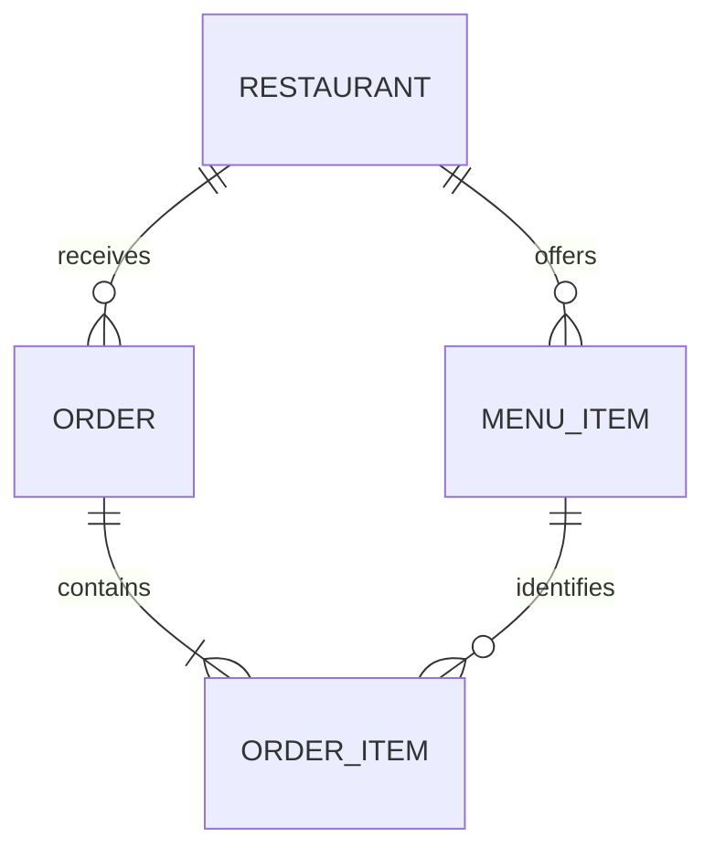
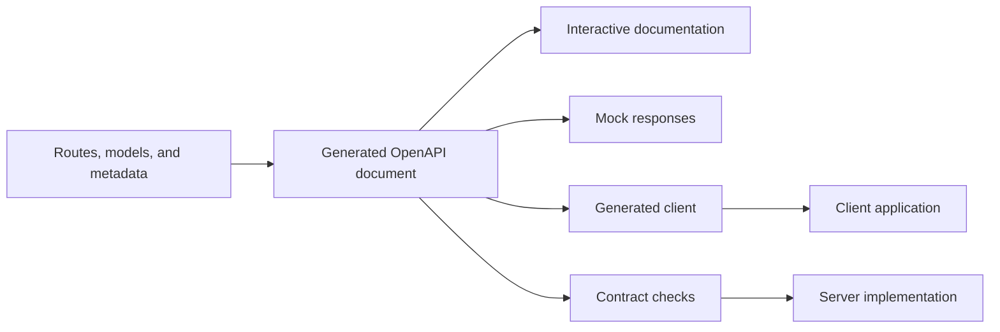
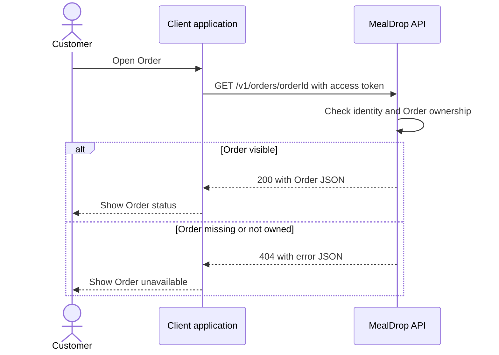

# Lecture 6: Data Modeling, API Design, and OpenAPI

A client and a server must agree on what a request means. A clear data model
supplies the concepts. An API supplies the actions. OpenAPI records the contract
so people and tools can use it.

```text
Product rules -> data model -> API contract -> OpenAPI -> client and server
```

This guide uses MealDrop. By the end, you should be able to model its main
entities, design a small API, describe one endpoint in OpenAPI, and call that
endpoint from a client.

## 1. Connect the previous lectures

- [Lecture 2](lecture-02-product-scope-and-system-boundaries.md) defined the
  actors, scope, and observable results. Those results tell us which actions
  the API needs.
- [Lecture 3](lecture-03-quality-requirements-workload-and-capacity.md) defined
  quality targets. A list response must have a size limit to keep its work
  and response time bounded.
- [Lecture 4](lecture-04-architecture-decomposition-and-data-flows.md) placed
  clients, servers, and access checks. We now define the messages between them.
- [Lecture 5](lecture-05-horizontal-scaling-caching-and-availability.md) added
  service instances. Each instance must expose the same API contract.

Use a small part of MealDrop:

- A Restaurant offers menu items.
- A Customer creates an Order for items from one Restaurant.
- The Customer lists and reads their own Orders.
- An Order preserves the items and prices agreed at submission.

## 2. Build a clear data model

### Use a modeling method and a shared notation

**Entity-Relationship (ER) modeling** describes entities, their attributes,
and their relationships. Peter Chen introduced the model in 1976. It gives
us a method for organizing product facts before choosing a database.

**UML** is a formal modeling standard maintained by the Object Management
Group. A UML class diagram can describe attributes, associations, and
multiplicity. ER modeling is the method used below; our Mermaid ER diagram
uses a common relationship notation rather than UML class-diagram notation.

Sources: [Chen: The Entity-Relationship Model](https://dl.acm.org/doi/10.1145/320434.320440)
and [OMG: UML 2.5.1](https://www.omg.org/spec/UML/2.5.1).

### Identify entities, attributes, and relationships

An **entity** has a continuing identity. A Restaurant can change its name and
remain the same Restaurant. An **attribute** describes an entity. A
**relationship** connects entities.

Use **snake_case for stored fields** and **camelCase for API fields**. Map
between them in the server. The stored model keeps the facts needed to build
a response; it does not need to store every response field.

| Entity     | Stored fields                                                                                  | Relationship                                   |
| ---------- | ---------------------------------------------------------------------------------------------- | ---------------------------------------------- |
| Restaurant | `restaurant_id`, `name`, `address`, `category`, `active`                                       | Offers many MenuItems                          |
| MenuItem   | `menu_item_id`, `restaurant_id`, `name`, `description`, `price`, `currency`, `available`       | Belongs to one Restaurant                      |
| Order      | `order_id`, `customer_id`, `restaurant_id`, `status`, `currency`, `delivery_fee`, `created_at` | Belongs to one Restaurant; contains OrderItems |
| OrderItem  | `order_id`, `line_number`, `menu_item_id`, `name_at_order`, `unit_price`, `quantity`           | Belongs to one Order                           |

Start with product rules, then draw the relationships:



**Cardinality**: Each MenuItem belongs to exactly one
Restaurant. A Restaurant can have no menu items yet. Each Order contains at
least one OrderItem.

### Add price and availability information

These example stored records describe the current Restaurant and one MenuItem.
The JSON below is a readable view of the records, using their stored names:

```json
{
  "restaurant": {
    "restaurant_id": "a1111111-1111-4111-8111-111111111111",
    "name": "Soup Kitchen",
    "address": "12 Market Street",
    "category": "Soups and salads",
    "active": true
  },
  "menu_item": {
    "menu_item_id": "b2222222-2222-4222-8222-222222222222",
    "restaurant_id": "a1111111-1111-4111-8111-111111111111",
    "name": "Tomato soup",
    "description": "Tomato soup with bread",
    "price": "4.50",
    "currency": "EUR",
    "available": true
  }
}
```

- Restaurant `active` says whether it currently accepts new Orders.
- MenuItem `available` says whether this item can currently be ordered.
- Both must be true at submission. Recheck them on the server; the client's
  menu can be old. An Order's `status: "active"` has its own meaning, defined
  in the API section.
- A price needs an amount and a currency. Every item and charge in this example
  uses EUR.
- OrderItem keeps `name_at_order` and `unit_price` from the agreed purchase.
  A later menu change does not rewrite an existing Order.

### Derive where possible

**Derive where possible** to avoid stored values getting out of sync.
`subtotal` means the sum of item prices multiplied by their quantities,
before the delivery fee. `total` adds that fee.

```text
subtotal = sum(quantity * agreed unit price)
total = subtotal + agreed delivery fee
```

For two soups at `4.50`, the subtotal is `9.00`. With a delivery fee of `2.00`,
the total is `11.00`. This example uses tax-inclusive prices and no other
charges or discounts.

Store the agreed unit prices, quantities, currency, and delivery fee. Always
compute `subtotal` and `total` when building the API response. Do not store
those computed fields in this model or accept them as trusted client input.
This prevents a quantity or price change from leaving a second stored total
incorrect. Use decimal arithmetic for the calculation.

**Try it:** A Customer orders two soups. Tomorrow, the Restaurant renames the
soup and changes its price. Which fields should the old Order display, and
where should those facts come from?

Reading: DDIA, first edition, Chapter 2, "Data Models and Query Languages."
The [book site](https://dataintensive.net/) introduces the book. Focus on
relationships and the cost of duplicated facts.

## 3. Turn User actions into an API

### Start with REST and resources

**REST** means Representational State Transfer. It is an architectural style
for client-server interaction. Clients work with named resources through a
uniform interface and exchange representations of those resources.

A **resource** is a concept the API names, such as an Order. Its JSON response
is a **representation**, not the resource itself. A **collection** contains
resources of one kind, such as the Customer's Orders.

For a REST-style HTTP API:

- Use URLs to identify resources and collections.
- Use standard HTTP methods and status codes with consistent meanings.
- Keep requests self-contained: send the identity and input needed for that
  request. The server still keeps persistent product data.
- State when responses can be cached, and protect private data.

Full REST also uses links in representations to guide available actions.
This lecture focuses on resource names, representations, and HTTP semantics.
The same Order resource could have a JSON or XML representation.

An **API contract** defines the accepted request and the promised response.
A resource can combine several entities. An Order response can contain its
OrderItems and a computed total. The server maps stored `order_id` to public
`orderId` and computes derived fields.

Source: [Fielding: REST, Chapter 5](https://ics.uci.edu/~fielding/pubs/dissertation/rest_arch_style.htm).

### Choose actions for the resources

| User action     | Method and path                         | Success                                          |
| --------------- | --------------------------------------- | ------------------------------------------------ |
| Create an Order | `POST /v1/orders`                       | `201 Created`, Order body, and `Location` header |
| List my Orders  | `GET /v1/orders?status=active&limit=20` | `200 OK` with a bounded, filtered list           |
| Read my Order   | `GET /v1/orders/{orderId}`              | `200 OK` with the Order                          |

Use methods consistently:

- `GET`: read a resource or collection.
- `POST`: submit data for processing, often to create a resource.
- `PUT`: replace the state at a known resource URL.
- `PATCH`: apply a partial change.
- `DELETE`: remove a resource where the product permits removal.

Choose the actions the product needs. An accepted food Order cannot be undone
by deleting its record. Cancellation would need its own business rules.
A `GET` must not request a business change, such as creating an Order.

Source: [Google AIP-121: Resource-oriented design](https://google.aip.dev/121)
and [RFC 9110, Section 9: Methods](https://www.rfc-editor.org/rfc/rfc9110.html#section-9).

### Separate input from output

```http
POST /v1/orders
Content-Type: application/json
Authorization: Bearer <access-token>

{
  "restaurantId": "a1111111-1111-4111-8111-111111111111",
  "items": [
    {
      "menuItemId": "b2222222-2222-4222-8222-222222222222",
      "quantity": 2
    }
  ]
}
```

- The client supplies the selected Restaurant, items, and quantities.
- The server gets the Customer ID from authentication.
- The server validates the request and sets the Order ID and status.
- The server uses the agreed item prices. A complete checkout also needs a
  rule for confirming those prices with the Customer.

After creating the Order, the server returns `201 Created`, a `Location`
header with its read URL, the agreed items and prices, and computed amounts:
`subtotal` and `total` are response fields, not stored Order fields.

```json
{
  "orderId": "c3333333-3333-4333-8333-333333333333",
  "restaurantId": "a1111111-1111-4111-8111-111111111111",
  "status": "pending",
  "currency": "EUR",
  "items": [
    {
      "lineNumber": 1,
      "menuItemId": "b2222222-2222-4222-8222-222222222222",
      "nameAtOrder": "Tomato soup",
      "unitPrice": "4.50",
      "quantity": 2
    }
  ],
  "subtotal": "9.00",
  "deliveryFee": "2.00",
  "total": "11.00",
  "createdAt": "2026-10-11T12:00:00Z"
}
```

For the read endpoint in the OpenAPI example, return a compact Order summary.
It uses public field names chosen for clients:

```json
{
  "orderId": "c3333333-3333-4333-8333-333333333333",
  "restaurantId": "a1111111-1111-4111-8111-111111111111",
  "status": "pending",
  "total": "11.00",
  "currency": "EUR",
  "createdAt": "2026-10-11T12:00:00Z"
}
```

Here, `pending` means the local Order is recorded and further work is required.
Creating that resource does not confirm payment or Restaurant acceptance.
Define the result in words as well as fields.

### Filter the Order collection with a query parameter

The path identifies the collection. The `status` query parameter selects
which Orders appear in the response:

| Status      | Meaning in this MealDrop example                                   |
| ----------- | ------------------------------------------------------------------ |
| `pending`   | Recorded, awaiting the Restaurant's decision                       |
| `active`    | Accepted by the Restaurant; preparation or delivery is in progress |
| `completed` | Delivery is confirmed                                              |

These are broad Customer-facing statuses. Detailed workflow states come later.
The examples follow Orders through delivery; rejection and cancellation would
need their own defined statuses in a full API.

```http
GET /v1/orders?status=active&limit=20
Authorization: Bearer <access-token>
Accept: application/json
```

This returns `200 OK` with summaries of the authenticated Customer's active
Orders, newest first:

```json
{
  "orders": [
    {
      "orderId": "d4444444-4444-4444-8444-444444444444",
      "restaurantId": "a1111111-1111-4111-8111-111111111111",
      "status": "active",
      "total": "11.00",
      "currency": "EUR",
      "createdAt": "2026-10-11T11:30:00Z"
    }
  ],
  "nextCursor": null
}
```

Change the query to `GET /v1/orders?status=pending&limit=20`:

```json
{
  "orders": [
    {
      "orderId": "c3333333-3333-4333-8333-333333333333",
      "restaurantId": "a1111111-1111-4111-8111-111111111111",
      "status": "pending",
      "total": "11.00",
      "currency": "EUR",
      "createdAt": "2026-10-11T12:00:00Z"
    }
  ],
  "nextCursor": null
}
```

For `GET /v1/orders?status=completed&limit=20`, only delivered Orders appear:

```json
{
  "orders": [
    {
      "orderId": "e5555555-5555-4555-8555-555555555555",
      "restaurantId": "a1111111-1111-4111-8111-111111111111",
      "status": "completed",
      "total": "11.00",
      "currency": "EUR",
      "createdAt": "2026-10-10T18:00:00Z"
    }
  ],
  "nextCursor": null
}
```

The response shape stays the same for each filter. Apply the filter before
limiting the results. Omitting `status` returns all statuses. An empty value
or an unsupported value returns `400` with `code: "invalid_status"`.

`nextCursor: null` means there are no more results for this query. If another
page exists, return an opaque cursor string; the client sends it with the
same `status` filter to obtain that page. A valid filter with no matching
Orders returns `200 OK` with an empty list:

```json
{
  "orders": [],
  "nextCursor": null
}
```

**Try it:** The Customer has 25 completed Orders and two active Orders. What
should `status=active&limit=20` return? Why would limiting all Orders before
filtering give a wrong result?

### Define validation and errors

| Input       | Example rule                                                          |
| ----------- | --------------------------------------------------------------------- |
| Identity    | Require a valid access token; check ownership on every private action |
| JSON body   | Accept only documented fields; reject missing required fields         |
| Items       | Require 1-20 available items, all from a Restaurant accepting Orders  |
| Quantity    | Require a whole count from 1 through 99                               |
| Order ID    | Require a valid UUID; return only an Order owned by the Customer      |
| List limit  | Default to 20; accept 1-100                                           |
| List status | Optional; accept one of `pending`, `active`, or `completed`           |

These limits are example product choices. A list contract should also state
its ordering and how to obtain another page, such as through an opaque cursor.
The database implementation comes later.

Use status codes and stable machine-readable errors:

| Status                    | Meaning for this API                                        |
| ------------------------- | ----------------------------------------------------------- |
| `400 Bad Request`         | Malformed JSON, an invalid path ID, or invalid field values |
| `401 Unauthorized`        | Missing or invalid authentication                           |
| `404 Not Found`           | No Order visible to this Customer                           |
| `503 Service Unavailable` | The server cannot complete the operation now                |

```json
{
  "error": {
    "code": "invalid_quantity",
    "message": "quantity must be a whole count from 1 through 99"
  }
}
```

The client uses `code` to select behavior and `message` to explain the error.
Return the same `404` for a missing Order and an Order owned by another Customer.
Knowing a UUID does not grant permission.

**Check:** A client sends `customerId` and `status: "accepted"` in the creation
body. Which part of the contract should reject them, and why?

### Compare other API approaches

REST is one approach. The main difference below is how the client expresses
its intent. These approaches can share HTTP while exposing different contracts.

| Approach        | Main idea                                                 | Real example                                                                             | Main tradeoff                                                                                                |
| --------------- | --------------------------------------------------------- | ---------------------------------------------------------------------------------------- | ------------------------------------------------------------------------------------------------------------ |
| REST-style HTTP | Act on named resources with standard methods              | GitHub REST, such as `GET /repos/octocat/Hello-World`                                    | Consistent HTTP semantics; several resources may need several requests                                       |
| RPC             | Call a named remote procedure with arguments              | Ethereum JSON-RPC, such as `eth_blockNumber`                                             | Direct action names; clients depend on each procedure's contract                                             |
| gRPC            | Define typed RPC services and generate client/server code | A backend publishes to Google Cloud Pub/Sub through `google.pubsub.v1.Publisher.Publish` | Useful for server-to-server calls and streaming; browser access needs suitable gRPC-Web tooling or a gateway |
| GraphQL         | Query a typed schema and choose the returned fields       | GitHub's GraphQL API returns selected Repository and Owner fields                        | Flexible response shapes; query cost and access checks need planning                                         |

gRPC is an RPC framework, not a separate architectural opposite to RPC. It
normally uses Protocol Buffers and HTTP/2. The contract defines service methods
and request/response messages; generated clients make those methods available
in each supported language.

An Ethereum JSON-RPC request names the method in the body:

```json
{
  "jsonrpc": "2.0",
  "method": "eth_blockNumber",
  "params": [],
  "id": 1
}
```

A GitHub GraphQL query selects the fields it needs:

```graphql
query {
  repository(owner: "octocat", name: "Hello-World") {
    name
    owner {
      login
    }
  }
}
```

The GraphQL response follows that selection under a `data` field. RPC chooses
a procedure; GraphQL chooses fields; REST-style HTTP identifies a resource
and applies a method. Select the approach that fits the callers and actions.

Sources: [GitHub REST: Get a repository](https://docs.github.com/en/rest/repos/repos#get-a-repository),
[Ethereum JSON-RPC](https://ethereum.org/en/developers/docs/apis/json-rpc/),
[gRPC introduction](https://grpc.io/docs/what-is-grpc/introduction/),
[Google Cloud Pub/Sub RPC reference](https://cloud.google.com/pubsub/docs/reference/rpc/google.pubsub.v1),
and [GitHub GraphQL](https://docs.github.com/en/graphql/guides/introduction-to-graphql).

### Choose the message format

An API approach and a message format are separate choices. Formats encode the
request and response; the transport carries those bytes. Here are common
serialization formats:

| Format           | Advantages                                                | Costs or limitations                                                        | Common use                               |
| ---------------- | --------------------------------------------------------- | --------------------------------------------------------------------------- | ---------------------------------------- |
| JSON             | Readable text; broad browser and language support         | Field names add size; exact decimal values need a deliberate representation | Public HTTP APIs and browser clients     |
| XML              | Readable text; namespaces and document-schema tooling     | Verbose messages and more mapping work for simple objects                   | Document exchange and SOAP integrations  |
| Protocol Buffers | Compact binary messages; typed schemas and generated code | Requires schema/tooling; raw messages are harder to inspect                 | gRPC and service-to-service messages     |
| Avro             | Binary encoding and writer/reader schema resolution       | Readers need access to the writer schema; schema changes need coordination  | Data pipelines, event streams, and files |

We use **JSON** for MealDrop. Keep API field names in camelCase and money
amounts as decimal strings with a currency. XML, Protocol Buffers, and Avro
are alternatives when their benefits fit the integration.

Sources: [JSON: RFC 8259](https://www.rfc-editor.org/rfc/rfc8259.html),
[XML: W3C](https://www.w3.org/TR/xml/),
[Protocol Buffers overview](https://protobuf.dev/overview/), and
[Avro specification](https://avro.apache.org/docs/1.12.0/specification/).

**Try it:** Which approach would you choose for a public Order API, a call
between two backend services, and a blockchain-node operation? Give one reason
for each choice.

## 4. Generate the contract in OpenAPI

**OpenAPI** is a standard format for describing HTTP APIs. An OpenAPI document
can be YAML or JSON. It records paths, methods, parameters, request bodies,
response schemas, and authentication requirements.

For this course, **always generate the OpenAPI document from source code**.
The source defines routes, request and response models, validation rules, and
API metadata. Framework tooling turns those definitions into the document.
Change the source, then regenerate the schema and documentation.
Declare realistic example values on the source models and operations so the
generated document can display useful sample requests and responses.

For example, [FastAPI](https://fastapi.tiangolo.com/tutorial/first-steps/)
automatically publishes an OpenAPI document at `/openapi.json` from the route
and model definitions. OpenAPI supports other workflows; source-code generation
is the workflow we use here.

```text
Routes + request/response models + API metadata
  -> generated OpenAPI document
  -> documentation and generated clients
```

Generation needs complete source definitions. It cannot infer every possible
error or ownership rule from arbitrary application logic. Declare those
responses and requirements in the source and check the running API against them.

| OpenAPI field | Purpose                                         |
| ------------- | ----------------------------------------------- |
| `openapi`     | Version of the OpenAPI format                   |
| `info`        | API title and description version               |
| `servers`     | Base URLs for connecting to the API             |
| `paths`       | Operations available at each path               |
| `parameters`  | Path, query, header, or cookie inputs           |
| `requestBody` | Body accepted by an operation                   |
| `responses`   | Status codes, media types, and response bodies  |
| `components`  | Reusable schemas and security definitions       |
| `security`    | Authentication schemes required by an operation |

### Describe the read and list endpoints

The YAML below shows what the generated document looks like for the
Order-summary read and filtered list. Its server URL is an example. Save a
copy as `openapi.yaml` to inspect it in a tool. Make API changes in source
code and regenerate this output.

```yaml
openapi: 3.1.1
info:
  title: MealDrop Order API
  version: 1.0.0
servers:
  - url: https://api.mealdrop.example/v1
security:
  - bearerAuth: []
paths:
  /orders:
    get:
      operationId: listOrders
      summary: List Orders owned by the current Customer
      parameters:
        - name: status
          in: query
          description: Omit to include all statuses
          schema:
            type: string
            enum:
              - pending
              - active
              - completed
            example: active
        - name: limit
          in: query
          schema:
            type: integer
            minimum: 1
            maximum: 100
            default: 20
            example: 20
        - name: cursor
          in: query
          description: Continue a page with the same status filter
          schema:
            type: string
      responses:
        "200":
          description: Matching Orders, newest first
          content:
            application/json:
              schema:
                $ref: "#/components/schemas/OrderList"
        "400":
          description: Invalid status, limit, or cursor
          content:
            application/json:
              schema:
                $ref: "#/components/schemas/Error"
              example:
                error:
                  code: invalid_status
                  message: status must be pending, active, or completed
        "401":
          description: Authentication required
          content:
            application/json:
              schema:
                $ref: "#/components/schemas/Error"
              example:
                error:
                  code: authentication_required
                  message: Sign in to read Orders
        "503":
          description: Service unavailable
          content:
            application/json:
              schema:
                $ref: "#/components/schemas/Error"
              example:
                error:
                  code: service_unavailable
                  message: Orders are temporarily unavailable
  /orders/{orderId}:
    get:
      operationId: getOrder
      summary: Read an Order owned by the current Customer
      parameters:
        - name: orderId
          in: path
          required: true
          schema:
            type: string
            format: uuid
            example: c3333333-3333-4333-8333-333333333333
      responses:
        "200":
          description: Order found
          content:
            application/json:
              schema:
                $ref: "#/components/schemas/OrderSummary"
        "400":
          description: Invalid Order ID
          content:
            application/json:
              schema:
                $ref: "#/components/schemas/Error"
              example:
                error:
                  code: invalid_order_id
                  message: orderId must be a valid UUID
        "401":
          description: Authentication required
          content:
            application/json:
              schema:
                $ref: "#/components/schemas/Error"
              example:
                error:
                  code: authentication_required
                  message: Sign in to read Orders
        "404":
          description: No Order visible to this Customer
          content:
            application/json:
              schema:
                $ref: "#/components/schemas/Error"
              example:
                error:
                  code: order_not_found
                  message: No Order is visible to this Customer
        "503":
          description: Service unavailable
          content:
            application/json:
              schema:
                $ref: "#/components/schemas/Error"
              example:
                error:
                  code: service_unavailable
                  message: Orders are temporarily unavailable
components:
  securitySchemes:
    bearerAuth:
      type: http
      scheme: bearer
  schemas:
    OrderSummary:
      type: object
      required:
        - orderId
        - restaurantId
        - status
        - total
        - currency
        - createdAt
      properties:
        orderId:
          type: string
          format: uuid
          example: c3333333-3333-4333-8333-333333333333
        restaurantId:
          type: string
          format: uuid
          example: a1111111-1111-4111-8111-111111111111
        status:
          type: string
          description: Current Order status; clients must handle new values
          example: pending
        total:
          type: string
          description: Computed from agreed item prices, quantities, and delivery fee
          example: "11.00"
          readOnly: true
        currency:
          type: string
          example: EUR
        createdAt:
          type: string
          format: date-time
          example: "2026-10-11T12:00:00Z"
    OrderList:
      type: object
      required:
        - orders
        - nextCursor
      properties:
        orders:
          type: array
          items:
            $ref: "#/components/schemas/OrderSummary"
        nextCursor:
          type:
            - string
            - "null"
          description: Next page token, or null when there are no more results
          example: null
      example:
        orders:
          - orderId: d4444444-4444-4444-8444-444444444444
            restaurantId: a1111111-1111-4111-8111-111111111111
            status: active
            total: "11.00"
            currency: EUR
            createdAt: "2026-10-11T11:30:00Z"
        nextCursor: null
    Error:
      type: object
      required:
        - error
      properties:
        error:
          type: object
          required:
            - code
            - message
          properties:
            code:
              type: string
              example: invalid_request
            message:
              type: string
              example: Request validation failed
```

Read the document from the outside in:

1. Combine `servers.url` with the path to get
   `https://api.mealdrop.example/v1/orders/{orderId}`.
2. `get` supplies the HTTP method. `operationId` gives tools a stable name.
3. The read path requires a UUID `orderId`. The list accepts optional query
   parameters: `status`, `limit`, and `cursor`.
4. The security requirement declares a Bearer token.
5. `responses` defines success and errors.
6. `$ref` reuses a schema from `components` instead of copying it.

These schemas describe JSON messages. They do not select database column types.
A description of security also needs a server implementation that checks the
token and Order ownership.

Source: [OpenAPI Specification 3.1.1](https://spec.openapis.org/oas/v3.1.1.html),
especially the OpenAPI, Operation, Schema, and Security Scheme objects.

### Use the document during development



- Generate the document from the server source during development and CI.
- Preview it in [Swagger Editor](https://editor.swagger.io/). Confirm that the
  path, response fields, and authentication scheme are visible.
- Use a mock server so the client team can work before the server is ready.
- Generate a client library to avoid hand-writing every path and JSON shape.
- Check example requests and responses against the document. In CI, detect
  changes that would break the published contract.

The document and implementation can drift. Generated clients reduce repeated
work, but tool capabilities vary; generated types alone do not validate every
runtime response. Keep contract checks and normal UI error handling.

**Try it:** Mark `orderId` as optional in the source response model, then
regenerate the document. Next, rename its public field and regenerate again.
What changes in the schema, and which client assumptions break? Restore the
original model before continuing.

## 5. Connect a client to the server

The browser downloads the client application. That application makes HTTP
requests to the API over HTTPS.



The client combines its configured base URL with the resource path, sends the
required authentication, and reads the HTTP status and JSON response. Use the
development, test, or production base URL selected by the application's
configuration.

The UI needs clear states for an in-progress request, an available Order,
a sign-in requirement, an unavailable Order, and a failed request:

| Client state              | What the Customer sees |
| ------------------------- | ---------------------- |
| Request in progress       | Loading indicator      |
| `200`                     | Order status           |
| `401`                     | Sign-in prompt         |
| `404`                     | Order unavailable      |
| Server or network failure | A clear error state    |

An OpenAPI-generated client builds requests and maps responses. The UI still
decides how to display loading, success, and errors.

## 6. Define API policies

A useful API needs stable rules for change, access, list results, and resource
use. State these rules in the contract so clients can behave consistently.

### Versioning and compatibility

A mobile client can remain installed for months. A browser tab can also run
old code after the server changes. Treat those clients as part of the design.

Our example uses a major API version in the path: `/v1/orders`. A compatible
change can stay in `v1`. A breaking change needs a migration plan, such as a
new `/v2/orders` contract while existing clients continue using `v1`.

| Change                                             | Compatibility decision                               |
| -------------------------------------------------- | ---------------------------------------------------- |
| Add an optional response field                     | Usually compatible if clients accept unknown fields  |
| Add an optional request field with the old default | Can preserve existing behavior                       |
| Rename `orderId` or change its representation      | Breaks clients that use the old field                |
| Make an optional request field required            | Breaks old requests                                  |
| Add a status value                                 | Requires a documented client fallback for new values |
| Change the meaning of `pending`                    | Can break behavior even when JSON has the same shape |

Keep public field names, meanings, and operation IDs stable. When a breaking
change is needed, publish the new contract, give clients time to move, measure
remaining old-version use, and communicate the retirement date.

Sources: [Google AIP-180: Backwards compatibility](https://google.aip.dev/180)
and [AIP-185: API Versioning](https://google.aip.dev/185). Path versioning is the
choice for this example; headers are another possible API convention.

**Try it:** The server adds `estimatedDeliveryAt` as an optional response field.
Later it replaces `status` with `state`. Which change can stay in `v1`, and
what client assumptions must you check?

### Authorization: who may act on which resource?

- **Authentication** identifies the caller.
- **Authorization** decides what that caller may do.

A Customer may read their own Orders. A Restaurant User may change only menus
for a Restaurant they manage. Check permission on the server for each action
and resource. A valid token or a known resource ID does not grant every action.

Use `401` for missing or invalid authentication. Use `403 Forbidden` when an
identified caller lacks permission and it is acceptable to reveal that result.
For private Order reads, keep the `404` policy from Section 3 so the API does
not reveal another Customer's Order. Apply the same ownership rule to lists.

Source: [OWASP: Broken Object Level Authorization](https://owasp.org/API-Security/editions/2023/en/0xa1-broken-object-level-authorization/).

### Pagination: return a bounded part of a collection

Pagination splits a large result into manageable responses. Common variants are:

| Variant          | Example                         | Useful property                         | Limitation                                                      |
| ---------------- | ------------------------------- | --------------------------------------- | --------------------------------------------------------------- |
| Page number      | `?page=2&pageSize=20`           | Easy page navigation                    | New or removed records can shift later pages                    |
| Offset and limit | `?offset=20&limit=20`           | Explicit number of records to skip      | Large offsets can be costly; records can shift between requests |
| Cursor           | `?cursor=opaque-token&limit=20` | Continue from a server-defined position | Usually requires following pages in order                       |

Page-number pagination commonly maps to offset pagination. With pages starting
at 1, page 2 of size 20 skips the first 20 results. Cursor pagination fits
MealDrop's changing Order history; the response already supplies `nextCursor`.

For every variant, define the default and maximum size, a stable ordering,
and how the client knows it has reached the end. In our API:

- `limit` defaults to 20 and has a maximum of 100.
- Results are ordered by newest `createdAt`, with `orderId` breaking ties.
- The client follows `nextCursor` while keeping the same `status` filter.
- `nextCursor: null` means the end; an empty collection is still `200 OK`.

A cursor is a position token. Check identity and ownership on each page.
Pagination does not by itself freeze the data while the client reads it.

Source: [Google AIP-158: Pagination](https://google.aip.dev/158), especially
page tokens, opacity, and keeping query arguments consistent.

### Filtering, sorting, and rate limits

**Filtering** selects which records match, such as `status=active`. **Sorting**
sets their order. Keep the permitted filters and default ordering explicit.
If a future API adds a `sort` parameter, document its allowed values and keep
that choice consistent while following pages.

**Rate limits** bound request frequency per caller or another documented scope.
When a caller exceeds the limit, return `429 Too Many Requests`. A `Retry-After`
header can tell the client when it may try again. The client should wait
instead of sending requests continuously.

A page-size limit bounds one response. A rate limit bounds repeated requests.
Both help keep the service usable for other Customers.

Source: [RFC 6585, Section 4: 429 Too Many Requests](https://www.rfc-editor.org/rfc/rfc6585.html#section-4).

**Check:** A Customer follows an active-Order cursor but changes the filter to
`completed`. Why should the server reject that cursor? Which access check is
still required even when the cursor is valid?

## 7. Apply the method to Lab 5

Open [Lab 5: Model the Dashboard and Define Its API](../labs/05-domain-data-model/README.md).
Cover market data and the private Watchlist.

1. Describe the full logical model, fields, relationships, and derived values.
2. Describe every current client endpoint. State inputs, access rules,
   success results, errors, filters, and pagination.
3. Turn those descriptions into source routes and models. Generate OpenAPI
   for the complete API and inspect its examples in a viewer.
4. Trace a client flow: base URL, authentication, requests, responses, and UI states.
5. Record versioning, ownership, pagination, and basic rate-limit policies.

The lab handoff gives the complete submission requirements. The next lecture
covers database design, data types, constraints, indexes, CAP, and safe
creation behavior. Lab 5 requires the logical model and API contract.

## References: read with a question

- [Martin Kleppmann: _Designing Data-Intensive Applications_](https://dataintensive.net/),
  first edition, Chapter 2, "Data Models and Query Languages."
  **Question:** Which facts should be shared and which must preserve history?
  The linked site introduces the book; the chapter is assigned reading.
- [Google AIP-121](https://google.aip.dev/121).
  **Question:** Why can an API resource have a different shape from stored data?
- [OpenAPI Specification 3.1.1](https://spec.openapis.org/oas/v3.1.1.html) and
  [FastAPI: First Steps](https://fastapi.tiangolo.com/tutorial/first-steps/).
  **Question:** Which source definitions generate paths, schemas, and security?
- [Chen: The Entity-Relationship Model](https://dl.acm.org/doi/10.1145/320434.320440)
  and [OMG: UML 2.5.1](https://www.omg.org/spec/UML/2.5.1).
  **Question:** Which model and notation make entities and relationships clear?
- [Fielding: REST](https://ics.uci.edu/~fielding/pubs/dissertation/rest_arch_style.htm).
  **Question:** How do a resource and its representation differ?
- [Google AIP-158: Pagination](https://google.aip.dev/158).
  **Question:** Which query choices must stay the same between pages?
- [Google AIP-180](https://google.aip.dev/180) and
  [AIP-185](https://google.aip.dev/185).
  **Question:** Can an old client still work after this API change?

### Further reading: browser integration

- [MDN: CORS](https://developer.mozilla.org/en-US/docs/Web/HTTP/Guides/CORS).
  **Question:** What must an API configure when the browser application and
  API have different origins?
